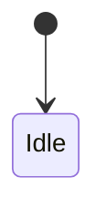

## What is the problem

<!-- Explain the root cause, affected gateway models / WHO subsystems, and any linked issues or discussions. -->

Fixes #<!-- issue number, if applicable -->

---

## What is the solution

1. **...**:
   - 
2. **...**:
   - 

---

## State Diagram

<!-- Include a Mermaid stateDiagram-v2 or flowchart illustrating the state machine, frame flow, or routing logic (or write "N/A — docs / CI / template change only"). -->

---

## Hardware Verification

<!-- Describe live gateway/actuator verification and user confirmation if tested on physical hardware (or write "N/A"). -->

- 

---

## How is it tested

<!-- List the unit / trace-replay test functions added or updated, plus pytest, ruff, verify_ha_standards.py, and sync_documentation.py results. -->

- `tests/test_...py::test_...`:
  - 

---

## Where are the traces

<!-- Link to the bus trace fixtures under `tests/fixtures/traces/...` or describe the gateway model, firmware, and captured frames (or write "N/A" if not a protocol/device change). -->

- 

---

## What does the Firmware Oracle / Encyclopedia say

<!-- Summarize the OpenWebNet Encyclopedia (`WHO` / `WHAT` / `Dimension` records) and Firmware Oracle (`firmware_oracle.json` / `trace-corpus.tsv`) evidence (or write "N/A"). -->

1. **OpenWebNet Encyclopedia (`WHO = ...`)**:
   - 
2. **Firmware Oracle**:
   - 

---

## Checklist

- [ ] **PR Description:** Follows the structured sections above (`What is the problem`, `What is the solution`, `State Diagram`, `How is it tested`, `Where are the traces`, `What does the Firmware Oracle / Encyclopedia say`).
- [ ] **Trace-Backed (if protocol/device change):** Behavior is verified against real OpenWebNet bus traces or gateway firmware fixtures rather than guessed.
- [ ] **V2 Architecture:** New or modified entities implement `handle_event()` and do not manually subscribe via `async_dispatcher_connect`.
- [ ] **Tests & Linters:** `pytest`, `ruff`, and `scripts/verify_ha_standards.py` pass.
