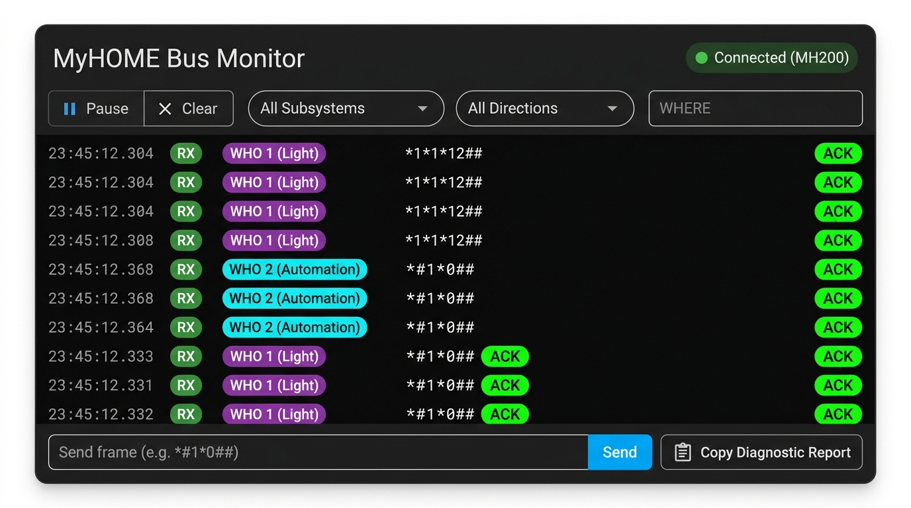

# MyHOME — OpenWebNet Integration for Home Assistant

Async-native Home Assistant integration for **BTicino / Legrand MyHOME** SCS bus systems connected via OpenWebNet TCP/IP gateways, powered by the decoupled [`OWNd`](https://github.com/OpenWebNet-HA/OWNd) protocol engine and maintained by the **[OpenWebNet-HA](https://github.com/OpenWebNet-HA)** community organisation.

[📖 User Manual](https://openwebnet-ha.github.io/MyHOME/) • [📦 Installation](#installation) • [⚙️ Quick Start](#quick-start) • [🏛️ Supported Hardware](#supported-hardware) • [📡 Bus Monitor](#bus-monitor--diagnostics) • [💬 Discussions](https://github.com/OpenWebNet-HA/MyHOME/discussions) • [🤝 Contributing](CONTRIBUTING.md) • [📄 License](#license)

---

## Highlights

- **UI-First Setup & Dynamic Auto-Discovery**: SSDP/UPnP gateway discovery, native Config, Options, and Subentry flows, and automatic on-wire SCS entity discovery — with optional `myhome.yaml` declarations for physical `#G` lighting groups, `WHO=6` door-entry locks, and DALI feature locks.
- **Declarative Hardware Gateway Profiles**: Model-aware session concurrency and adaptive per-target frame scheduling (`FrameScheduler`) across 11 BTicino and Legrand IP gateway families, prioritizing user commands and immediate cover `STOP` actions ahead of background sweeps.
- **Lighting, Motorized Covers & Climate**: Smooth dimmer fades, hardware-offloaded DIN actuator countdown timers (`WHO=1`), DALI HSV & DT8 Tunable White (`2000K–6535K`), calibrated shutter and Venetian slat-tilt kinematics with ~1 s live position interpolation (`WHO=2`), and Central Unit `3550` / `4695` whole-home climate coordination (`WHO=4`).
- **Multi-Room Audio & Streaming Proxy**: F441/F441M matrix routing, F500/F500N FM radio tuner controls with live RDS (`WHO=16` / `WHO=22`), and dynamic `DecoderPool` streaming from **Music Assistant** or **Spotify Connect** with analog gain-staging.
- **Native CEN / CEN+ Triggers & Bus Projection (`expose`)**: All 8 press, hold, release, and rotary dial device triggers directly in the Home Assistant automation editor (`WHO=15` / `WHO=25`), plus declarative HA-to-SCS bus projection (`WHO=1, 2, 4, 13, 18`) so physical wall pushbuttons can control Home Assistant entities with LED feedback.
- **Multi-Gateway Topologies & In-Band Diagnostics**: MAC-isolated multi-gateway routing, shared-bus warm-standby failover, self-clearing Home Assistant Repair issues, and a zero-socket built-in `<myhome-openwebnet-bus-monitor>` Lovelace card.

---

## User Manual & Documentation

Full setup guides, per-subsystem configuration references, automation recipes, and troubleshooting steps are published in the **MyHOME User Manual**:

👉 **[https://openwebnet-ha.github.io/MyHOME/](https://openwebnet-ha.github.io/MyHOME/)**

| Category | Manual Guides |
| :--- | :--- |
| **Getting Started** | [Configuration Overview](https://openwebnet-ha.github.io/MyHOME/latest/configuration/) • [Installation](https://openwebnet-ha.github.io/MyHOME/latest/getting-started/installation/) • [Hardware Compatibility](https://openwebnet-ha.github.io/MyHOME/latest/getting-started/hardware-compatibility/) • [Clean Uninstall](https://openwebnet-ha.github.io/MyHOME/latest/getting-started/removal/) |
| **Gateways & Bus** | [Gateways & Connection](https://openwebnet-ha.github.io/MyHOME/latest/configuration/gateways/) • [Gateway Identification](https://openwebnet-ha.github.io/MyHOME/latest/configuration/gateway-identification/) • [Expose HA Entities to SCS Bus](https://openwebnet-ha.github.io/MyHOME/latest/configuration/expose/) • [Services Reference](https://openwebnet-ha.github.io/MyHOME/latest/configuration/services/) |
| **Entity Domains** | [Lights & DALI](https://openwebnet-ha.github.io/MyHOME/latest/configuration/lights/) • [Covers & Travel-Time Calibration](https://openwebnet-ha.github.io/MyHOME/latest/configuration/covers/) • [Climate & Heating](https://openwebnet-ha.github.io/MyHOME/latest/configuration/climate/) • [Sound System & Streaming](https://openwebnet-ha.github.io/MyHOME/latest/configuration/media_player/) • [CEN / CEN+ Buttons](https://openwebnet-ha.github.io/MyHOME/latest/configuration/cen_cenplus/) • [Switches](https://openwebnet-ha.github.io/MyHOME/latest/configuration/switches/) • [Sensors & Energy](https://openwebnet-ha.github.io/MyHOME/latest/configuration/sensors/) • [Binary Sensors](https://openwebnet-ha.github.io/MyHOME/latest/configuration/binary-sensors/) • [Burglar Alarm](https://openwebnet-ha.github.io/MyHOME/latest/configuration/alarm/) |
| **Diagnostics & Recipes** | [Lovelace Bus Monitor Card](https://openwebnet-ha.github.io/MyHOME/latest/configuration/bus_monitor/) • [Home Assistant Repairs](https://openwebnet-ha.github.io/MyHOME/latest/diagnostics/repair-issues/) • [Dashboard Recipes](https://openwebnet-ha.github.io/MyHOME/latest/configuration/lovelace_recipes/) • [Use Cases](https://openwebnet-ha.github.io/MyHOME/latest/configuration/use_cases/) • [Troubleshooting](https://openwebnet-ha.github.io/MyHOME/latest/configuration/troubleshooting/) • [Known Limitations](https://openwebnet-ha.github.io/MyHOME/latest/configuration/known_limitations/) |
| **Protocol & Specs** | [Supported Functions Matrix](https://openwebnet-ha.github.io/MyHOME/latest/configuration/supported_functions/) • [OpenWebNet WHO Specifications](https://openwebnet-ha.github.io/MyHOME/latest/openwebnet-who-specifications/) • [Official Legrand Developer Portal](https://developer.legrand.com/local-interoperability/#PDF%20documentation) |

---

## Installation

> **Requirement:** Home Assistant **2026.3 or newer** (Python 3.14).

### Option 1: Home Assistant Marketplace (`2026.11+`) / HACS (`2026.3 – 2026.10`)

From **Home Assistant 2026.11** on, use the built-in **Home Assistant Marketplace** (**Settings → Marketplace**); existing HACS installations and custom repositories migrate automatically on upgrade. On **Home Assistant 2026.3 – 2026.10**, use **[HACS](https://hacs.xyz)**.

1. **Add or locate the repository:**
    - **Home Assistant 2026.11+ (Marketplace):** Open **Settings → Marketplace** and search for **MyHOME** *(if not yet listed in your catalog, select **Add from link** in the upper-right corner, enter `https://github.com/OpenWebNet-HA/MyHOME`, select **Integration** if prompted, and select **Add**)*.
    - **Home Assistant 2026.3 – 2026.10 (HACS):** Open **HACS → Integrations** and search for **MyHOME** *(or open `⋮` → **Custom repositories** and add `https://github.com/OpenWebNet-HA/MyHOME` with category **Integration**)*.
2. **Install & restart:**
    - Open **MyHOME** and select **Install** in Marketplace (or **Download** in HACS). To pick a specific release tag, open `⋮` → **Install another version** (Marketplace) or `⋮` → **Redownload** (HACS).
    - Restart Home Assistant (**Settings → System → Restart**).

> [!CAUTION]
> **Migrating from a personal fork? Never delete your MyHOME integration entry or click "Delete and uninstall"!**
> Deleting the integration under *Settings → Devices & services* — or choosing **Delete and uninstall** in Marketplace's "integration in use" dialog — removes all configured gateways, devices, and entities.
>
> - **If a fork is marked Installed in Marketplace (`2026.11+`):** update `/config/custom_components/myhome/` in place using **Option 2 (Manual / Terminal)** below instead of clicking **Delete and uninstall**.
> - **If a fork was only added as a link (not installed) in Marketplace (`2026.11+`):** open **Settings → Marketplace → `⋮` → Custom repositories**, click **Remove** next to the fork, and add `OpenWebNet-HA/MyHOME` via **Add from link**.
> - **On Home Assistant `< 2026.11` (HACS):** open **HACS → `⋮` → Custom repositories**, remove the fork URL, and add `OpenWebNet-HA/MyHOME`.

### Option 2: Manual Archive or Terminal & SSH

*(Also recommended for installing pre-release tags ahead of stable catalog releases — see the [Installation Manual](https://openwebnet-ha.github.io/MyHOME/latest/getting-started/installation/) for 1-click SSH and Docker commands.)*

1. Download `myhome.zip` from [GitHub Releases](https://github.com/OpenWebNet-HA/MyHOME/releases).
2. Extract `myhome.zip` into `/config/custom_components/myhome/` (so `manifest.json` is at `/config/custom_components/myhome/manifest.json`).
3. Restart Home Assistant (**Settings → System → Restart**).

> [!WARNING]
> **Never keep backup folders inside `/config/custom_components/` (such as `custom_components/myhome.backup`)!** Home Assistant scans every subdirectory under `custom_components/` containing a `manifest.json`, causing import failures (`No module named 'custom_components.myhome.backup'`). Store any safety backups outside `custom_components/` (for example `/config/myhome_backup/`).

For clean uninstallation steps, see [Removal & Clean Uninstall](https://openwebnet-ha.github.io/MyHOME/latest/getting-started/removal/).

---

## Quick Start

1. **Add Your Gateway**: Navigate to **Settings → Devices & Services → Add Integration → MyHOME**. Confirm an SSDP/UPnP-discovered gateway (**Configure**), or enter your gateway's IP address, port (default `20000`), and OpenWebNet / HMAC password manually.
2. **Automatic Bus Discovery**: MyHOME establishes dedicated command (`*99*0##`) and event (`*99*1##`) sessions, identifies your gateway hardware profile, and automatically discovers devices from bus sweeps and live frames.
3. **Fine-Tune in UI**: Click **Configure** on the MyHOME integration card to adjust command worker concurrency, dimmer transition mode (`software_stepped` or `native`), audio decoder pool mappings, exposed Home Assistant entities, probe-less thermo actuator switches, or ignored addresses.
4. **Optional `myhome.yaml` Overlay**: Physical SCS lighting groups (`#1`–`#255`), `WHO=6` video door-entry locks, F500/F500N tuner sources, and DALI `lock_features` declarations can be placed in `/config/myhome.yaml` — see the [Configuration Overview](https://openwebnet-ha.github.io/MyHOME/latest/configuration/).

---

## Supported Hardware

### Gateway Profiles

<!-- GATEWAY_PROFILES_START -->
| Gateway Model | Protocol Support | Max Command Workers | Inter-Frame Delay | UPnP Discovery | Notes |
|---|---|---|---|---|---|
| **F454** | OpenWebNet / HMAC | 4 workers | 50 ms | ✅ Port 49153 | Full high-speed multi-session support |
| **F455** | OpenWebNet / HMAC | 4 workers | 50 ms | ✅ Port 49153 | Basic gateway (single SCS bus) |
| **F461** | OpenWebNet / HMAC | 4 workers | 50 ms | ❌ Manual | Compact DIN Ethernet Web Server |
| **MH202** | OpenWebNet / HMAC | 2 workers | 100 ms | ✅ Port 49153 | Modern scenario programmer gateway |
| **MH201** | OpenWebNet | 1 worker | 100 ms | ✅ Port 49153 | Second-generation scenario programmer |
| **MyHomeServer1** | OpenWebNet / HMAC | 4 workers | 20 ms | ✅ SSDP | Cloud/local hybrid gateway |
| **MH200N** | OpenWebNet | 1 worker | 150 ms | ✅ SSDP | Second-generation scenario programmer |
| **MH200** *(Legacy)* | OpenWebNet | 1 worker | 150 ms | ✅ SSDP | Strict single-session pacing; watchdog hardened |
| **H4890 / AM4890** | OpenWebNet | 1 worker | 50 ms | ✅ SSDP | 3.5" Touch screen display IP gateway (Axolute / Livinglight) |
| **F452 / F453 / F453AV** | OpenWebNet | 1 worker | 150 ms | ✅ Port 49153 | Audio/video & web server gateway |
| **H4684 / H/L4684** | OpenWebNet | 1 worker | 50 ms | ✅ SSDP | Colour touch screen IP gateway (Axolute / LivingLight) |
<!-- GATEWAY_PROFILES_END -->

*This table is automatically updated from gateway profile definitions and hardware specifications.*

### Supported Entity Domains & Automations

<!-- SUPPORTED_DOMAINS_START -->
| Domain | WHO | Capabilities |
|---|---|---|
| **`light`** | WHO=1 | On/Off, Dimmers with brightness control & transitions (stepped & native), DALI DT8 Tunable White (Dimension 14, 2000K–6535K), HS/RGB colour, Hardware-offloaded bus timers (`myhome.turn_on_timed` / `timer` parameter) |
| **`switch`** | WHO=1 | Relays, auxiliary switches, socket actuators (switch/outlet device classes), Hardware-offloaded bus timers (`myhome.turn_on_timed` / `timer` parameter) |
| **`cover`** | WHO=1 / WHO=2 | Motorized shutters, blinds, roll-ups with state tracking, position-reporting actuators & virtual travel-time positioning; impulse gates & garage doors (`WHO=1`) with sensor feedback and an optional multi-factor approval workflow |
| **`lock`** | WHO=6 | Native video door entry strikes (`WHO=6`, configured in `myhome.yaml`) with constant-time PIN authentication and auto-relock |
| **`climate`** | WHO=4 | Heating, cooling, 4-pipe systems, thermostats, setpoints, fancoil 3-speed modes, offset tracking, Central Unit 3550 (`#0`) & 4695 (`#0#1`) master coordination & seasonal propagation |
| **`alarm_control_panel`** | WHO=5 | Central units (3485/3486), read-only state (disarmed / armed away / triggered), zone 0 broadcast sync; arm/disarm via AUX frames ([docs](docs/configuration/alarm.md)) |
| **`binary_sensor`** | WHO=1 / 9 / 25 | Magnetic contacts, door/window sensors, PIR motion, AUX channels (1–9), dry contacts (F482/3477), inverted contacts |
| **`sensor`** | WHO=1 / 4 / 18 | Power meters, energy counters (total/daily/monthly), temperature probes (3475), illuminance / lux sensors |
| **`button`** | WHO=14 / 2 / 16 / 22 | Hardware actuator lock/unlock for lights, switches & covers (WHO=14), cover travel time calibration buttons (per cover & gateway-wide, WHO=2), F500/F500N FM tuner Seek up / Seek down buttons (WHO=16 / 22) |
| **`number`** | WHO=16 / 22 | Direct manual FM radio frequency input & stepping (`87.50–108.00 MHz`, `0.05 MHz` step) for declared F500/F500N tuner sources (WHO=16 / 22) |
| **`media_player`** | WHO=16 / 22 | F441/F441M audio zones, F500/F500N FM radio tuners (presets, RDS, Media Browser, manual frequency & preset storage on WHO=16 & WHO=22), volume normalization, software mute, streaming dynamic proxy (Music Assistant / Spotify Connect) |
| **`device_trigger`** *(Automations)* | WHO=15 / 25 | Stateless CEN & CEN+ scenario pushbuttons with string-preserved addressing (`"0001"`), gateway MAC isolation, and 8 native UI trigger types (short press, long press start, held, release, rotary dials) |
<!-- SUPPORTED_DOMAINS_END -->

*This table is automatically updated from platform definitions and [`supported_functions.md`](docs/configuration/supported_functions.md).*

<strong>📊 Hardware Trace Availability Matrix (Real-Plant CI Corpus)</strong>

<!-- TRACE_MATRIX_START -->
| Gateway Model | WHO 0 Scenario | WHO 1 Lights | WHO 2 Autom. | WHO 3 Load | WHO 4 Climate | WHO 5 Alarm | WHO 6 Door | WHO 7 Video | WHO 8 Intercom | WHO 9 Power | WHO 13 Gateway | WHO 14 Lock | WHO 15 CEN | WHO 16 Audio | WHO 17 Scenario | WHO 18 Energy | WHO 22 Audio Diff. | WHO 25 Diag | WHO 1001 Diag | WHO 1004 Diag | WHO 1013 Diag | WHO 1022 Diag |
| :--- |  :---:  |  :---:  |  :---:  |  :---:  |  :---:  |  :---:  |  :---:  |  :---:  |  :---:  |  :---:  |  :---:  |  :---:  |  :---:  |  :---:  |  :---:  |  :---:  |  :---:  |  :---:  |  :---:  |  :---:  |  :---:  |  :---:  |
| **067292** |  | ✅ |  |  | ✅ |  |  |  |  |  | ✅ |  |  |  |  |  |  |  |  |  |  |  |
| **F453** |  |  | ✅ |  |  |  |  |  |  |  | ✅ |  |  |  |  |  |  |  |  |  | ✅ |  |
| **F453AV** |  | ✅ | ✅ |  | ✅ | ✅ |  |  |  |  | ✅ |  |  |  |  |  |  |  | ✅ |  |  |  |
| **F454** | ✅ | ✅ | ✅ |  | ✅ | ✅ |  |  |  | ✅ | ✅ | ✅ |  |  |  | ✅ |  | ✅ |  |  | ✅ |  |
| **F455** |  | ✅ | ✅ |  | ✅ |  |  |  |  |  | ✅ |  |  |  |  |  |  | ✅ | ✅ |  | ✅ |  |
| **F459** |  | ✅ | ✅ |  | ✅ |  |  |  |  |  | ✅ |  |  |  |  |  |  |  |  |  | ✅ |  |
| **F461** |  | ✅ | ✅ |  | ✅ |  |  |  |  |  | ✅ | ✅ |  |  |  |  |  |  | ✅ |  | ✅ |  |
| **H4684 / H/L4684** |  | ✅ | ✅ | ✅ | ✅ | ✅ | ✅ |  |  | ✅ | ✅ |  |  | ✅ |  |  | ✅ |  | ✅ | ✅ |  |  |
| **H4890 / AM4890** |  | ✅ | ✅ |  | ✅ | ✅ |  |  |  | ✅ |  |  |  | ✅ |  | ✅ | ✅ | ✅ |  |  |  |  |
| **MH200** |  | ✅ | ✅ |  |  | ✅ | ✅ |  | ✅ | ✅ | ✅ |  |  | ✅ | ✅ |  |  |  | ✅ |  | ✅ |  |
| **MH200N** | ✅ | ✅ | ✅ |  | ✅ | ✅ |  |  |  | ✅ | ✅ |  | ✅ | ✅ | ✅ | ✅ | ✅ | ✅ | ✅ |  | ✅ | ✅ |
| **MH201** | ✅ | ✅ | ✅ |  | ✅ |  |  |  |  |  | ✅ |  | ✅ |  |  | ✅ |  | ✅ |  |  |  |  |
| **MH202** |  | ✅ | ✅ |  | ✅ | ✅ | ✅ |  | ✅ | ✅ | ✅ | ✅ |  | ✅ |  | ✅ | ✅ | ✅ |  |  | ✅ |  |
| **MyHomeServer1** |  | ✅ | ✅ |  | ✅ |  |  | ✅ | ✅ | ✅ | ✅ | ✅ | ✅ |  |  | ✅ | ✅ | ✅ | ✅ |  | ✅ |  |
<!-- TRACE_MATRIX_END -->

*Checkmarks (✅) indicate that at least one anonymized bus capture in `tests/fixtures/` exercises that subsystem on the given gateway model. See [Trace Availability](https://openwebnet-ha.github.io/MyHOME/latest/trace-availability/) and [Issue #466](https://github.com/OpenWebNet-HA/MyHOME/issues/466) to contribute traces.*

---

## Bus Monitor & Diagnostics

MyHOME includes an in-band real-time bus monitor operating over the existing gateway event stream with **zero extra socket connections**:

  

- **Visual Card Picker**: Search for **"MyHOME OpenWebNet Bus Monitor"** under `+ Add Card` in any dashboard (`custom:myhome-openwebnet-bus-monitor`).
- **Live Frame Stream & Injector**: Subsystem badges (`WHO=1`, `WHO=2`, `WHO=4`, `WHO=15/25`, `WHO=16/22`, `WHO=18`), ACK/NACK highlighting, filtering by `WHO` / `WHERE` / RX/TX, offline trace replay, and syntax-validated manual frame injection.
- **Sanitized Diagnostics**: One-click diagnostic export from the card or via **Settings → Devices & Services → MyHOME → `⋮` → Download diagnostics**, with automatic credential, IP, MAC, and SSDP redaction.

Read the full [Lovelace Bus Monitor Card Guide](https://openwebnet-ha.github.io/MyHOME/latest/configuration/bus_monitor/).

---

## Quality & Development

MyHOME enforces 100% statement test coverage across all integration modules, `mypy --strict` type checking, empirical gateway firmware oracle conformance, and deterministic replay of anonymized real-plant OpenWebNet traces. For local setup, test runners, trace anonymization (`scripts/anonymize_plant_fixture.py`), and pull request guidelines, see **[CONTRIBUTING.md](CONTRIBUTING.md)** and **[ROADMAP.md](ROADMAP.md)**.

### Home Assistant Integration Quality Scale

<!-- START_QUALITY_SCALE -->

**Tier reached: 🏆 Platinum**

| Tier | Rules satisfied | Status |
| :--- | :---: | :--- |
| 🥉 Bronze | 20 / 20 | ✅ complete |
| 🥈 Silver | 10 / 10 | ✅ complete |
| 🥇 Gold | 21 / 21 | ✅ complete |
| 🏆 Platinum | 3 / 3 | ✅ complete |

_Self-audit of [`quality_scale.yaml`](custom_components/myhome/quality_scale.yaml) against the official [Integration Quality Scale](https://developers.home-assistant.io/docs/core/integration-quality-scale/rules/); a tier needs every rule of that tier and all lower tiers `done`/`exempt`. Updated by the [Integration Quality Scale workflow](https://github.com/OpenWebNet-HA/MyHOME/actions/workflows/quality-scale.yml); tiers are formally awarded only by Home Assistant core review._

<!-- END_QUALITY_SCALE -->

### Code Coverage

The integration maintains 5793 automated unit tests (100% line coverage across all modules) verified in CI on every pull request.

<strong>📊 Per-Module Coverage Breakdown (100% across all integration modules)</strong>

<!-- START_COVERAGE_TABLE -->

| Component / Module | Coverage | Notes |
|---|:---:|---|
| [`__init__.py`](custom_components/myhome/__init__.py) | **100%** | Setup lifecycle and zero-friction entity migration |
| [`access_policy.py`](custom_components/myhome/access_policy.py) | **100%** | Core integration component |
| [`alarm_control_panel.py`](custom_components/myhome/alarm_control_panel.py) | **100%** | Core integration component |
| [`binary_sensor.py`](custom_components/myhome/binary_sensor.py) | **100%** | Magnetic contacts, door/window sensors, motion sensors |
| [`bus_monitor.py`](custom_components/myhome/bus_monitor.py) | **100%** | In-band 500-frame circular ring buffer tap (0 extra sockets) |
| [`button.py`](custom_components/myhome/button.py) | **100%** | Scenario buttons and bus diagnostic pings |
| [`climate.py`](custom_components/myhome/climate.py) | **100%** | Heating, cooling, 4-pipe systems, and thermostat controls |
| [`config_flow.py`](custom_components/myhome/config_flow.py) | **100%** | Step handlers, user entry, reauth, and options flow |
| [`config_flow_audio.py`](custom_components/myhome/config_flow_audio.py) | **100%** | Core integration component |
| [`config_flow_discovery.py`](custom_components/myhome/config_flow_discovery.py) | **100%** | Core integration component |
| [`config_flow_expose.py`](custom_components/myhome/config_flow_expose.py) | **100%** | Core integration component |
| [`config_flow_options.py`](custom_components/myhome/config_flow_options.py) | **100%** | Core integration component |
| [`config_flow_thermo_switch.py`](custom_components/myhome/config_flow_thermo_switch.py) | **100%** | Core integration component |
| [`config_flow_topology.py`](custom_components/myhome/config_flow_topology.py) | **100%** | Core integration component |
| [`const.py`](custom_components/myhome/const.py) | **100%** | Protocol commands, dimensions, and integration constants |
| [`cover.py`](custom_components/myhome/cover.py) | **100%** | Motorized shutters, blinds, roll-ups with state tracking |
| [`cover_calibration.py`](custom_components/myhome/cover_calibration.py) | **100%** | Core integration component |
| [`cover_motion.py`](custom_components/myhome/cover_motion.py) | **100%** | Core integration component |
| [`cover_scope.py`](custom_components/myhome/cover_scope.py) | **100%** | Core integration component |
| [`cover_strategies/__init__.py`](custom_components/myhome/cover_strategies/__init__.py) | **100%** | Core integration component |
| [`cover_strategies/base.py`](custom_components/myhome/cover_strategies/base.py) | **100%** | Core integration component |
| [`cover_strategies/native.py`](custom_components/myhome/cover_strategies/native.py) | **100%** | Core integration component |
| [`cover_strategies/simple.py`](custom_components/myhome/cover_strategies/simple.py) | **100%** | Core integration component |
| [`cover_strategies/timed.py`](custom_components/myhome/cover_strategies/timed.py) | **100%** | Core integration component |
| [`cover_strategies/venetian.py`](custom_components/myhome/cover_strategies/venetian.py) | **100%** | Core integration component |
| [`data.py`](custom_components/myhome/data.py) | **100%** | Core integration component |
| [`decoder_allocation.py`](custom_components/myhome/decoder_allocation.py) | **100%** | Core integration component |
| [`decoder_companion.py`](custom_components/myhome/decoder_companion.py) | **100%** | Core integration component |
| [`decoder_pool.py`](custom_components/myhome/decoder_pool.py) | **100%** | Thread-safe streaming proxy audio pool |
| [`device_health.py`](custom_components/myhome/device_health.py) | **100%** | Core integration component |
| [`device_trigger.py`](custom_components/myhome/device_trigger.py) | **100%** | Stateless CEN/CEN+ scenario device automation triggers |
| [`diagnostics.py`](custom_components/myhome/diagnostics.py) | **100%** | Config entry diagnostics with sensitive data redaction |
| [`discovery.py`](custom_components/myhome/discovery.py) | **100%** | Core integration component |
| [`expose.py`](custom_components/myhome/expose.py) | **100%** | Core integration component |
| [`gateway.py`](custom_components/myhome/gateway.py) | **100%** | Hardware handler, lockout prevention, adaptive queue pacing |
| [`gateway_events.py`](custom_components/myhome/gateway_events.py) | **100%** | Core integration component |
| [`gateway_resync.py`](custom_components/myhome/gateway_resync.py) | **100%** | Core integration component |
| [`gateway_sessions.py`](custom_components/myhome/gateway_sessions.py) | **100%** | Core integration component |
| [`identity.py`](custom_components/myhome/identity.py) | **100%** | Core integration component |
| [`ignored.py`](custom_components/myhome/ignored.py) | **100%** | Core integration component |
| [`legacy_yaml.py`](custom_components/myhome/legacy_yaml.py) | **100%** | Core integration component |
| [`light.py`](custom_components/myhome/light.py) | **100%** | Relays, auto-dimmer detection, and brightness transitions |
| [`light_dali.py`](custom_components/myhome/light_dali.py) | **100%** | Core integration component |
| [`light_fade.py`](custom_components/myhome/light_fade.py) | **100%** | Core integration component |
| [`light_group.py`](custom_components/myhome/light_group.py) | **100%** | Core integration component |
| [`lock.py`](custom_components/myhome/lock.py) | **100%** | Core integration component |
| [`media_player.py`](custom_components/myhome/media_player.py) | **100%** | F441/F441M sound system zones, dynamic proxy, gain-staging |
| [`media_player_decoder.py`](custom_components/myhome/media_player_decoder.py) | **100%** | Core integration component |
| [`media_player_group.py`](custom_components/myhome/media_player_group.py) | **100%** | Core integration component |
| [`media_player_pool.py`](custom_components/myhome/media_player_pool.py) | **100%** | Core integration component |
| [`media_player_power.py`](custom_components/myhome/media_player_power.py) | **100%** | Core integration component |
| [`media_player_routing.py`](custom_components/myhome/media_player_routing.py) | **100%** | Core integration component |
| [`media_player_source.py`](custom_components/myhome/media_player_source.py) | **100%** | Core integration component |
| [`media_player_zone.py`](custom_components/myhome/media_player_zone.py) | **100%** | Core integration component |
| [`migrate.py`](custom_components/myhome/migrate.py) | **100%** | Core integration component |
| [`myhome_device.py`](custom_components/myhome/myhome_device.py) | **100%** | Home Assistant device registry schema compliance |
| [`number.py`](custom_components/myhome/number.py) | **100%** | Core integration component |
| [`poll_health.py`](custom_components/myhome/poll_health.py) | **100%** | Core integration component |
| [`repairs.py`](custom_components/myhome/repairs.py) | **100%** | Core integration component |
| [`router.py`](custom_components/myhome/router.py) | **100%** | Core integration component |
| [`sensor.py`](custom_components/myhome/sensor.py) | **100%** | Power meters, energy counters, and pulse sensors |
| [`services.py`](custom_components/myhome/services.py) | **100%** | Core integration component |
| [`sound_source.py`](custom_components/myhome/sound_source.py) | **100%** | Core integration component |
| [`switch.py`](custom_components/myhome/switch.py) | **100%** | Relay actuators, auxiliary switches, socket controllers |
| [`thermo_switch.py`](custom_components/myhome/thermo_switch.py) | **100%** | Core integration component |
| [`topology.py`](custom_components/myhome/topology.py) | **100%** | Core integration component |
| [`tuner_decode.py`](custom_components/myhome/tuner_decode.py) | **100%** | Core integration component |
| [`typing_compat.py`](custom_components/myhome/typing_compat.py) | **100%** | Core integration component |
| [`validate.py`](custom_components/myhome/validate.py) | **100%** | Device & gateway schemas, custom WHERE validators, sensor injections |
| [`websocket.py`](custom_components/myhome/websocket.py) | **100%** | WebSocket API for real-time bus streaming, history, and diagnostics |
| [`where_grammar.py`](custom_components/myhome/where_grammar.py) | **100%** | Core integration component |

<!-- END_COVERAGE_TABLE -->

---

## Credits & Attribution

Developed and maintained by the **[OpenWebNet-HA](https://github.com/OpenWebNet-HA)** community.

Special thanks to:

- **[@anotherjulien](https://github.com/anotherjulien)** for creating the original MyHOME integration and laying the protocol foundations.
- **[@GreenGrassBlueOcean](https://github.com/GreenGrassBlueOcean)** for the modernized async architecture, gateway profiles, streaming proxy, and automated test suite.
- **[@xtimmy86x](https://github.com/xtimmy86x)** for crafting the frontend user experience, administration panel, cover calibration interfaces, and hardware diagnostics.
- **[@gdluck](https://github.com/gdluck)** for outstanding engineering, invaluable ideas, and rigorous physical F461 plant measurements.
- **[@TheDarkWizard](https://github.com/TheDarkWizard)** for crucial CEN+ wire address captures (KW8011), WHO 1001 diagnostics, and tireless real-world hardware testing across Living Now controls and MyHomeServer1 setups.
- **[@wave68runner](https://github.com/wave68runner)** for authentic HL4684 touchscreen captures, BTicino 3550 thermoregulation sweeps, and tuner diagnostics.
- **[@Interstellar0verdrive](https://github.com/Interstellar0verdrive)** for deep hardware actuator analysis, cover timing/concurrency mechanics, and platform extensions.
- **[@fedem95](https://github.com/fedem95)**, **[@andreasorbelli](https://github.com/andreasorbelli)**, **[@mantovanellimatteo](https://github.com/mantovanellimatteo)**, **[@lyubomirtraykov](https://github.com/lyubomirtraykov)**, and **Cedric Rohou** for key bugfixes, platform extensions, and community testing.
- **[@GianlucaCh](https://github.com/GianlucaCh)** for preserving and contributing the 15-manual BTicino/Legrand specification archive (`OWN DOC.zip`), the `WHO_24.pdf` Lighting Management specification, and CEN+ community automation references.
- **[@nicolacavallo84](https://github.com/nicolacavallo84)** for the 70+ device plant captures and H4890 touchscreen multi-gateway traces that form foundational CI replay fixtures.
- **All community testers and trace providers** whose real-world bus captures keep our test suite grounded in real hardware (*"In traces we find the truth"*): **[@flow68000](https://github.com/flow68000)**, **[@manfredgittmaier-afk](https://github.com/manfredgittmaier-afk)**, **[@stefanvitz](https://github.com/stefanvitz)**, **[@eC0y0te](https://github.com/eC0y0te)**, **[@simo72mast-lab](https://github.com/simo72mast-lab)**, **[@lionelser](https://github.com/lionelser)**, **[@caiosweet](https://github.com/caiosweet)**, **[@f18m](https://github.com/f18m)**, **[@gimprota76](https://github.com/gimprota76)**, **[@paoloboatto](https://github.com/paoloboatto)**, **[@andrea-mag](https://github.com/andrea-mag)**, **[@cricri72](https://github.com/cricri72)**, **[@emil-d](https://github.com/emil-d)**, **[@marcob79](https://github.com/marcob79)**, **[@xduss](https://github.com/xduss)**, **[@pakob81](https://github.com/pakob81)**, **[@Depechie](https://github.com/Depechie)**, **[@nce2704](https://github.com/nce2704)**, **[@ricdijk](https://github.com/ricdijk)**, **[@imfreddie](https://github.com/imfreddie)**, **[@theveninjeremy](https://github.com/theveninjeremy)**, and **[@Yvan13120](https://github.com/Yvan13120)**.

---

## License

Copyright © 2020–2026 OpenWebNet-HA Community & Contributors.

Licensed under the **[Apache License 2.0](LICENSE)**, the same permissive open-source license used by Home Assistant Core and [`OWNd`](https://github.com/OpenWebNet-HA/OWNd).
