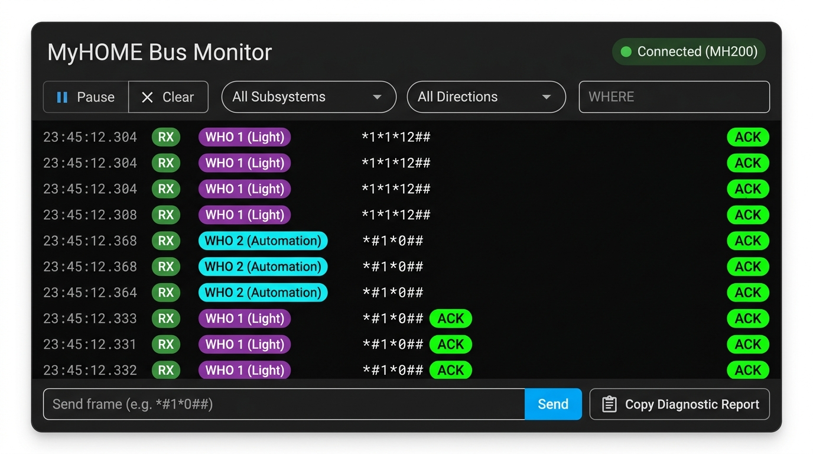

# MyHOME — OpenWebNet Integration for Home Assistant

[](https://github.com/OpenWebNet-HA/MyHOME/releases/tag/0.9.4)
[](https://github.com/OpenWebNet-HA/MyHOME/releases/tag/2.0.0b17)
[](https://github.com/OpenWebNet-HA/MyHOME/actions/workflows/hassfest.yml)
[](https://github.com/OpenWebNet-HA/MyHOME/actions/workflows/validate.yml)
[](https://hacs.xyz)
[](https://www.python.org/)
[-brightgreen.svg)](https://openwebnet-ha.github.io/MyHOME/beta/)
[](https://github.com/OpenWebNet-HA/MyHOME/actions/workflows/test-coverage.yaml)
[](https://app.codecov.io/gh/OpenWebNet-HA/MyHOME/tree/v2-phase1-architecture)
[](https://openwebnet-ha.github.io/MyHOME/beta/)
[](https://github.com/OpenWebNet-HA/MyHOME/discussions)
[](LICENSE)

Modern, async-native Home Assistant integration for **BTicino / Legrand MyHOME** SCS bus systems connected via OpenWebNet IP & Serial gateways.

Maintained by the **[OpenWebNet-HA](https://github.com/OpenWebNet-HA)** community organisation.

[⚖️ Version Comparison](#️-version-comparison-legacy-stable-vs-modern-beta) • [🧪 Testing & Reliability](#-testing--quality-comparison) • [📦 Installation](#-installation) • [🏛️ Supported Hardware](#️-supported-hardware--gateways) • [🌟 Key Features](#-modern-v2-features) • [📚 Full Documentation](https://openwebnet-ha.github.io/MyHOME/beta/) • [🗺️ Stable v2.0.0 PR #232](https://github.com/OpenWebNet-HA/MyHOME/pull/232)

---

> [!IMPORTANT]
> ### 🛡️ Current Stable Status vs. Active V2 Beta
>
> - **Current Stable Release ([v0.9.4](https://github.com/OpenWebNet-HA/MyHOME/releases/tag/0.9.4))**: The baseline release on `master` for users seeking proven production stability. Fully compatible with Home Assistant 2026.9 and earlier. HACS installs this version by default when pre-releases are not enabled.
> - **Active Field-Testing Beta ([v2.0.0b17](https://github.com/OpenWebNet-HA/MyHOME/releases/tag/2.0.0b17), succeeding [v2.0.0b16](https://github.com/OpenWebNet-HA/MyHOME/releases/tag/2.0.0b16))**: Modernized async-native architecture (`OWNd 2.0.0b13`), cover end-stop settle recomputation & 0.5 s limit-stop cutoff, configurable `min_position_delta` (1–5 %), BTicino 3550 Central Unit hydration & diagnostics, F500/F500N FM tuner frequency, seek & preset controls (`WHO=16` / `WHO=22`), Burglar alarm HomeKit arm-away, Legrand 067292 touchscreen gateway alias, declarative HA-to-SCS bus `expose` engine (`WHO 1/2/4/13/18`), Venetian blind slat tilt, impulse gate/garage covers & door-entry locks (`WHO 1/2/6/8`), and 100.0% test statement coverage (**5,324 tests** in `v2.0.0b17`, up from 4,393 in `v2.0.0b16`). Built for Home Assistant ≥ 2026.3 (Python 3.14).
> - **Roadmap to Stable v2.0.0**: Once community field-testing on the beta line is concluded, **[PR #232](https://github.com/OpenWebNet-HA/MyHOME/pull/232)** will merge the V2 architecture directly into `master`, making it the official stable default for all users.
> - **Zero-Friction Migration**: Upgrading to V2 safely preserves all existing device names, custom entity IDs (`light.living_room`), and gateway configurations. Unique IDs migrate automatically (`MAC-WHERE` → `MAC-WHO-WHERE`), and legacy `myhome.yaml` settings (`travel_time`, `lock_features`) are automatically persisted into the config entry ([#742](https://github.com/OpenWebNet-HA/MyHOME/pull/742)).

---

## ⚖️ Version Comparison: Legacy Stable vs. Modern Beta

Understanding the technical differences between **Legacy Stable (`v0.9.4`)**, **Previous Beta (`v2.0.0b16`)**, and **Latest Beta (`v2.0.0b17`)**:

| Feature / Architecture | Legacy Stable (`v0.9.4` on `master`) | Beta `v2.0.0b16` *(21 Oct 2026)* | Latest Beta `v2.0.0b17` *(4 Nov 2026)* |
| :--- | :--- | :--- | :--- |
| **Home Assistant Core** | Compatible with HA 2026.9 and earlier | **Core ≥ 2026.3** (Python 3.14 async-native; HA 2026.11 registry migration ready) | **Core ≥ 2026.3** (Python 3.14 async-native; HA 2026.11 logger, media player & registry migration verified) |
| **IoT Class** | `local_polling` | **`local_push`** (real-time bus event stream push) | **`local_push`** (real-time bus event stream push) |
| **Protocol Engine** | `OWNd==0.7.48` | **`OWNd==2.0.0b11`** (zero private symbols/shims, strict builder validation, whole-hour TZ guard) | **`OWNd==2.0.0b13`** (hardened WHO 4 setpoints, vacation program parser, WHO 6 gateway boundaries, WHO 16 station range validation, clean profile aliases) |
| **Quality Scale** | Unranked legacy structure | **🏆 Platinum Tier (54/54 self-assessed rules)** + bundled brand icons ([#741](https://github.com/OpenWebNet-HA/MyHOME/pull/741)) — formal tier awarded upon upstream core review | **🏆 Platinum Tier (54/54 self-assessed rules satisfied/exempt in `quality_scale.yaml`)** |
| **Type Safety** | Untyped | **100% `mypy --strict` compliance** across all **73 modules** (verified against pinned `OWNd==2.0.0b11`) | **100% `mypy --strict` compliance** across all **73 modules** (verified against pinned `OWNd==2.0.0b13`) |
| **State Storage & Config** | Global `hass.data[DOMAIN]` dictionaries | Strongly-typed **`entry.runtime_data`** + automatic persistence of `myhome.yaml` device settings (`travel_time`, `lock_features`) into config entry ([#742](https://github.com/OpenWebNet-HA/MyHOME/pull/742)) | Strongly-typed **`entry.runtime_data`** (`MyHOMERuntimeData`), UI Config/Options/Subentry Flows with manual gateway model ID ([#804](https://github.com/OpenWebNet-HA/MyHOME/pull/804)), `WHO=4` thermo switch subentries ([#817](https://github.com/OpenWebNet-HA/MyHOME/pull/817)), UI binary sensor inversion ([#829](https://github.com/OpenWebNet-HA/MyHOME/pull/829)) & `ignored_addresses` |
| **Device Discovery** | Requires manual YAML (`myhome.yaml`) | **Zero-config Dynamic Bus Auto-Discovery** + phantom-entity suppression on blank start ([#686](https://github.com/OpenWebNet-HA/MyHOME/pull/686)) & ON-dimmer brightness probing ([#742](https://github.com/OpenWebNet-HA/MyHOME/pull/742)) | **Zero-config Dynamic Bus Auto-Discovery** with per-firmware startup sweep filtering ([#794](https://github.com/OpenWebNet-HA/MyHOME/pull/794)) and subentry entity persistence |
| **Expose HA to SCS Bus** | ❌ Not supported | **✅ Declarative `expose` engine ([#750](https://github.com/OpenWebNet-HA/MyHOME/pull/750))**: virtual `WHO 1/2` actuators (with wall LED feedback), `WHO 4` temperature probes, `WHO 18` energy meters, and `WHO 13` bus clock | **✅ Declarative `expose` engine**: virtual `WHO 1/2` actuators (with physical wall LED feedback), `WHO 4` temperature probes, `WHO 18` energy meters, and `WHO 13` bus clock sync |
| **Gateway Profiles** | Fixed, hardcoded socket pacing | **12 Declarative Profiles** verified against empirical **Firmware Oracle** ([#745](https://github.com/OpenWebNet-HA/MyHOME/pull/745)), plus `H4684`/`LGRH4684` & `MH201` auto-ID ([#652](https://github.com/OpenWebNet-HA/MyHOME/pull/652), [#722](https://github.com/OpenWebNet-HA/MyHOME/pull/722)) | **12 Declarative Profiles** + **Legrand `067292` / `573958` / `078479` touchscreen aliases ([#854](https://github.com/OpenWebNet-HA/MyHOME/pull/854))** (F454, F455, F461, MH202, MH201, MHS1, MH200N, MH200, H4890, HL4684, F452/F453AV, 3578) |
| **Supported Transports** | TCP Network Gateways only | **TCP IP + USB/Serial (Legrand 3578 / OpenZigBee)** + shared HA websession discovery ([#757](https://github.com/OpenWebNet-HA/MyHOME/pull/757)) | **TCP IP + USB/Serial (Legrand 3578 / OpenZigBee)** |
| **Multi-Gateway Plants** | ❌ Single gateway only (cross-talk on multi-GW) | **Namespaced routing, plant isolation & warm-standby failover** | **Namespaced routing, plant isolation & warm-standby failover ([#453](https://github.com/OpenWebNet-HA/MyHOME/issues/453))** |
| **Command Scheduling** | FIFO queue (user commands blocked behind sweeps) | **Unified `FrameScheduler` ([#738](https://github.com/OpenWebNet-HA/MyHOME/pull/738))** with per-target (`WHO`, `WHERE`) serialization, cover `STOP` overtaking queued frames ([#694](https://github.com/OpenWebNet-HA/MyHOME/pull/694)), and low-priority fade steps ([#739](https://github.com/OpenWebNet-HA/MyHOME/pull/739)) | **Unified `FrameScheduler`** with per-target queue serialization, priority user frames over background polls, and immediate cover stop-overtake |
| **Lighting (`WHO=1`)** | Basic On/Off relays & stepped dimming | Hardware staircase bus timers, smooth software fades, **DALI DT8 Tunable White (2000K–6535K)**, DALI feature locks, 2-digit Area 0 point addresses (`01`–`09`, [#713](https://github.com/OpenWebNet-HA/MyHOME/pull/713)) | Adds **coarse preset brightness curve correction ([#828](https://github.com/OpenWebNet-HA/MyHOME/pull/828))**, **fine dimmer preset echo Dimension 1 refresh ([#852](https://github.com/OpenWebNet-HA/MyHOME/pull/852))**, and **shared-address light + motion sensor coexistence ([#781](https://github.com/OpenWebNet-HA/MyHOME/pull/781))** |
| **Covers (`WHO=2` & `WHO=1`)** | Basic Open / Close / Stop | State tracking, position-reporting actuators, Venetian blind slat tilt ([#508](https://github.com/OpenWebNet-HA/MyHOME/pull/508)), impulse gate/garage covers on `WHO=1` ([#667](https://github.com/OpenWebNet-HA/MyHOME/pull/667)), `min_motor_pulse` floor & endpoint full runs ([#702](https://github.com/OpenWebNet-HA/MyHOME/pull/702), [#708](https://github.com/OpenWebNet-HA/MyHOME/pull/708)) | Adds **cover end-stop settle recomputation & 0.5 s limit-stop cutoff from known positions ([#834](https://github.com/OpenWebNet-HA/MyHOME/pull/834), [#847](https://github.com/OpenWebNet-HA/MyHOME/pull/847))**, **configurable `min_position_delta` ([#778](https://github.com/OpenWebNet-HA/MyHOME/pull/778))**, and cover calibration configurator cutoffs ([#843](https://github.com/OpenWebNet-HA/MyHOME/pull/843)) |
| **Locks & Door Entry (`WHO=6` / `WHO=8`)** | ❌ Not supported | Native `lock` platform for `WHO=6` door-entry strikes with constant-time PIN verification, auto-relock, and `WHO=8` intercom call events ([#667](https://github.com/OpenWebNet-HA/MyHOME/pull/667)) | Native `lock` platform with **WHO 6 gateway boundary containment ([#835](https://github.com/OpenWebNet-HA/MyHOME/pull/835))** preventing cross-gateway broadcast leaks |
| **Climate (`WHO=4`)** | Basic zone thermostats | Central Unit 3550 (`#0`) & 4695 (`#0#1`) master coordination, season frames, holiday/vacation programs, zone humidity sensors ([#712](https://github.com/OpenWebNet-HA/MyHOME/pull/712)), F461 zone polling | Adds **BTicino 3550 Central Unit startup hydration, diagnostic flags & repair alerts ([#846](https://github.com/OpenWebNet-HA/MyHOME/pull/846))**, **probe-less thermo actuator switches & ghost pump suppression ([#817](https://github.com/OpenWebNet-HA/MyHOME/pull/817), [#825](https://github.com/OpenWebNet-HA/MyHOME/pull/825))**, and Dimension 22 crash-form & interface routing guards ([#816](https://github.com/OpenWebNet-HA/MyHOME/pull/816), [#849](https://github.com/OpenWebNet-HA/MyHOME/pull/849)) |
| **Sound System (`WHO=16` / `WHO=22`)** | ❌ Not supported | Full audio matrix (F441/F441M), Dynamic Streaming Proxy, `WHO=22` FM tuner frequency/preset/RDS decoding | Adds **F500/F500N FM tuner manual frequency `number` input, seek `button` entities, Media Browser, preset storage & `WHO=22` command parity ([#839](https://github.com/OpenWebNet-HA/MyHOME/pull/839))** and **`WHO=16` station range validation ([#844](https://github.com/OpenWebNet-HA/MyHOME/pull/844))** |
| **Burglar Alarm (`WHO=5`)** | ❌ Not supported | Dedicated `alarm_control_panel` (3485/3486), partition states, AUX arm/disarm workflows | Dedicated `alarm_control_panel` + **HomeKit-compatible arm-away read-only auxiliary panel mode ([#842](https://github.com/OpenWebNet-HA/MyHOME/pull/842))** |
| **CEN / CEN+ & Scenarios (`WHO=15/17/25`)** | Raw event listeners; required external blueprints | 8 native UI device triggers with 4-digit string-preserved addressing (`"0001"`), `WHO=25` Scenario Plus, `WHO=17` scene events | 8 native UI device triggers with 4-digit string-preserved addressing (`"0001"`), `WHO=25` Scenario Plus, `WHO=17` scene events |
| **Diagnostics & Health** | Raw logs only | Self-clearing HA Repair issues (`actuator_fault`), `ignored_addresses`, gateway kernel distribution sweep telemetry | Self-clearing HA Repair issues, configurable `ignored_addresses`, and **3550 Central Unit diagnostic flags & actionable repair alerts ([#846](https://github.com/OpenWebNet-HA/MyHOME/pull/846))** |
| **Lovelace Frontend** | ❌ None | Built-in `<myhome-openwebnet-bus-monitor>` card with stricter WebSocket input bounds ([#747](https://github.com/OpenWebNet-HA/MyHOME/pull/747)) and 1-click sanitized diagnostic report export | Built-in `<myhome-openwebnet-bus-monitor>` card with live streaming feed, offline replay tab, syntax-validated frame injector, and sanitized diagnostics |
| **License** | **AGPL-3.0** (per `master` repository [`LICENSE`](LICENSE)) | **Apache-2.0** (per published `2.0.0b16` release / [`LICENSE`](https://github.com/OpenWebNet-HA/MyHOME/blob/v2-phase1-architecture/LICENSE), aligning with Home Assistant Core) | **Apache-2.0** (per published `2.0.0b17` release / [`LICENSE`](https://github.com/OpenWebNet-HA/MyHOME/blob/v2-phase1-architecture/LICENSE), aligning with Home Assistant Core) |

> 🔗 **Release Changelogs & GitHub Compares**:
> - [`v2.0.0b17` Release Notes & Assets](https://github.com/OpenWebNet-HA/MyHOME/releases/tag/2.0.0b17) • [`Compare 2.0.0b16...2.0.0b17` (61 PRs)](https://github.com/OpenWebNet-HA/MyHOME/compare/2.0.0b16...2.0.0b17)
> - [`v2.0.0b16` Release Notes & Assets](https://github.com/OpenWebNet-HA/MyHOME/releases/tag/2.0.0b16) • [`Compare 2.0.0b15...2.0.0b16` (83 PRs)](https://github.com/OpenWebNet-HA/MyHOME/compare/2.0.0b15...2.0.0b16)
> - [`v2.0.0b15` Release Notes & Assets](https://github.com/OpenWebNet-HA/MyHOME/releases/tag/2.0.0b15) • [`Compare 2.0.0b14...2.0.0b15` (41 PRs)](https://github.com/OpenWebNet-HA/MyHOME/compare/2.0.0b14...2.0.0b15)
> - [Full Cross-Beta Capability Matrix (`v2.0.0b1` → `v2.0.0b17`)](https://openwebnet-ha.github.io/MyHOME/beta/roadmap/beta-differences/)

---

## 🧪 Testing & Quality Comparison

The modernization from legacy to V2 established an extensive automated testing and verification foundation (real-world validation across diverse physical gateways remains an ongoing community effort):

| Testing Dimension | Legacy Stable (`v0.9.4` on `master`) | Beta `v2.0.0b16` *(21 Oct 2026)* | Latest Beta `v2.0.0b17` *(4 Nov 2026)* |
| :--- | :--- | :--- | :--- |
| **Automated Tests** | **0 tests** (no pytest suite or test files in repository) | **4,393 automated tests** passing | **5,324 automated tests** passing (+931 new regression & conformance tests) |
| **Statement Coverage** | **0%** tracked | **Strict 100.0% statement coverage** across all 73 modules | **Strict 100.0% statement coverage** across all **73 modules** |
| **Branch Coverage** | Untracked | Enforced via automated zero-tolerance coverage gates in CI | Enforced via automated zero-tolerance coverage gates in CI |
| **Trace Replay Engine** | ❌ None (testing required live physical hardware) | Automated CI replay of authentic on-wire traces from real European installations (F454, F455, F461, MH200, MH200N, MH201, MH202, MyHomeServer1, H4890, HL4684, Living Now controls) | Expanded with **live BTicino 3550 Central Unit captures, HL4684 touchscreen sweeps, Legrand 067292 traces, F454 burglar alarm (3486), and F461 physical plant fixtures** |
| **Firmware Oracle Conformance** | ❌ None | Automated Firmware Oracle Verification (`test_firmware_oracle_conformance.py`, [#745](https://github.com/OpenWebNet-HA/MyHOME/pull/745)) | Automated Firmware Oracle Verification cross-checking frames and gateway profiles against hash-pinned emulated firmware verdicts |
| **Golden Frame Corpus** | ❌ None | Expanded OpenWebNet Golden Corpus (`WHO 0–25, 1001–1022`) + zero-deprecation enforcement | **OpenWebNet Golden Corpus** with multi-authority calibrated frame fixtures across 11 subsystems (`WHO 0–25, 1001–1022`) |
| **Snapshot Testing** | ❌ None | Syrupy snapshot suites verifying diagnostics exports, entity registry schemas, and state trees | **Syrupy snapshot suites** verifying diagnostics exports, entity registry schemas, and state trees |
| **CI Automation** | 2 workflows (`hassfest`, basic `validate`) | 10 comprehensive CI workflows + containerized HA smoke (`stable`/`beta`/`dev`) & `OWNd` lockstep smoke gates | **10 comprehensive CI workflows** + containerized HA smoke (`stable`/`beta`/`dev`) & `OWNd` lockstep smoke gates |
| **Anti-Drift Sentinels** | ❌ None | Automated sentinel (`scripts/sync_documentation.py`) + gateway profile oracle verification | **Automated sentinel (`scripts/sync_documentation.py`)** continuously validating documentation, tables, and code alignment |

---

## 📦 Installation

> [!CAUTION]
> **⚠️ Never store backup copies inside `/config/custom_components/` (e.g. `myhome.backup`)!**  
> Home Assistant automatically discovers **all** subdirectories containing `manifest.json` under `custom_components`. Backups inside this folder cause startup crashes (`Unable to import component: No module named 'custom_components.myhome.backup'`). Always keep backups **outside** in `/config/myhome_backup/`.

### 🚀 Installing the Active Beta (v2.0.0b17 — Recommended for HA ≥ 2026.3)

> [!TIP]
> **Recommended Beta Install Method**: In **HACS 2.0+**, pre-release toggle switches can get stuck in an *"unavailable"* loop due to upstream registry caching, or show validation warnings before PR #232 merges. Using **Method 1 (Terminal & SSH)** below provides a direct, verified installation that safely preserves your configuration and entity IDs. *(To install the previous `2.0.0b16` milestone instead, replace `2.0.0b17` with `2.0.0b16` in the download URL.)*

#### Method 1: Verified Script via Terminal & SSH Add-on (⭐ Recommended)

Open the **Terminal** in your Home Assistant sidebar and paste:

```bash
if cd /config/custom_components; then
    # Move any legacy in-place backup out of custom_components to prevent loader crashes:
    [ -d myhome.backup ] && mv myhome.backup /config/myhome_backup_old

    # Download and extract into a temporary directory first to verify archive integrity:
    TMP_DIR=$(mktemp -d)
    if wget -O "$TMP_DIR/myhome.zip" https://github.com/OpenWebNet-HA/MyHOME/releases/download/2.0.0b17/myhome.zip && \
       unzip -q "$TMP_DIR/myhome.zip" -d "$TMP_DIR/myhome" && \
       [ -f "$TMP_DIR/myhome/manifest.json" ]; then
        BACKUP_OK=1
        if [ -d myhome ]; then
            rm -rf /config/myhome_backup && cp -r myhome /config/myhome_backup || BACKUP_OK=0
        fi

        if [ "$BACKUP_OK" -eq 1 ]; then
            if rm -rf myhome && mv "$TMP_DIR/myhome" myhome; then
                rm -rf "$TMP_DIR"
                echo "Installation verified. Restarting Home Assistant..."
                ha core restart
            else
                echo "Error: Replacement failed. Recovery files preserved in $TMP_DIR and /config/myhome_backup."
            fi
        else
            echo "Error: Backup failed. Existing installation left intact. Recovery files preserved in $TMP_DIR."
        fi
    else
        echo "Error: Download or extraction verification failed. Existing installation left intact."
        rm -rf "$TMP_DIR"
    fi
else
    echo "Error: Failed to navigate to /config/custom_components. Directory does not exist."
fi
```

*(For **Home Assistant Container / Docker**, run on your Docker host:)*
```bash
docker exec -it homeassistant bash -c 'cd /config/custom_components || { echo "Error: /config/custom_components not found."; exit 1; }; [ -d myhome.backup ] && mv myhome.backup /config/myhome_backup_old; TMP_DIR=$(mktemp -d); if ! wget -O "$TMP_DIR/myhome.zip" https://github.com/OpenWebNet-HA/MyHOME/releases/download/2.0.0b17/myhome.zip || ! unzip -q "$TMP_DIR/myhome.zip" -d "$TMP_DIR/myhome" || [ ! -f "$TMP_DIR/myhome/manifest.json" ]; then echo "Error: Download or extraction verification failed. Existing installation left intact."; rm -rf "$TMP_DIR"; exit 1; fi; if [ -d myhome ]; then rm -rf /config/myhome_backup && cp -r myhome /config/myhome_backup || { echo "Error: Backup failed. Existing installation left intact. Recovery files preserved in $TMP_DIR."; exit 1; }; fi; if ! (rm -rf myhome && mv "$TMP_DIR/myhome" myhome); then echo "Error: Replacement failed. Recovery files preserved in $TMP_DIR and /config/myhome_backup."; exit 1; fi; rm -rf "$TMP_DIR" && echo "Installation verified. Restarting container..."' && docker restart homeassistant
```

#### Method 2: Manual Installation (Archive / Samba)

1. Download the release package:  
   👉 **[Download myhome.zip (v2.0.0b17 — Latest Beta)](https://github.com/OpenWebNet-HA/MyHOME/releases/download/2.0.0b17/myhome.zip)** • **[Download myhome.zip (v2.0.0b16)](https://github.com/OpenWebNet-HA/MyHOME/releases/download/2.0.0b16/myhome.zip)** (or browse all [GitHub Releases](https://github.com/OpenWebNet-HA/MyHOME/releases))
2. Open your configuration directory via Samba Share, Studio Code Server, or File Editor.
3. Extract `myhome.zip` directly into `/config/custom_components/myhome/` (overwriting existing files).
4. Restart Home Assistant (**Settings → System → Restart**).

#### Method 3: HACS (Custom Repository)

1. In Home Assistant, open **HACS → Integrations**.
2. Click the top-right menu (`⋮`) → **Custom repositories**.
3. Add repository URL: `https://github.com/OpenWebNet-HA/MyHOME` with type **Integration**.
4. Open the **MyHOME** card in HACS, click `⋮` → **Redownload**, ensure **Show beta versions** is toggled ON, select **`2.0.0b17`** (or **`2.0.0b16`**), and click **Download**.
5. Restart Home Assistant.

---

### 🛡️ Installing or Staying on Current Stable (v0.9.4)

If you prefer proven production stability or wish to wait for the final `v2.0.0` stable merge:

* **Via HACS (Default)**: Search for **MyHOME** in HACS and click **Download** (keep *Show beta versions* disabled). HACS will automatically install **v0.9.4**.
* **Via Terminal & SSH**:
  ```bash
  if cd /config/custom_components; then
      # Move any legacy in-place backup out of custom_components to prevent loader crashes:
      [ -d myhome.backup ] && mv myhome.backup /config/myhome_backup_old

      # Download and extract into a temporary directory first to verify archive integrity:
      TMP_DIR=$(mktemp -d)
      if wget -O "$TMP_DIR/myhome.zip" https://github.com/OpenWebNet-HA/MyHOME/releases/download/0.9.4/myhome.zip && \
         unzip -q "$TMP_DIR/myhome.zip" -d "$TMP_DIR/myhome" && \
         [ -f "$TMP_DIR/myhome/manifest.json" ]; then
          BACKUP_OK=1
          if [ -d myhome ]; then
              rm -rf /config/myhome_backup && cp -r myhome /config/myhome_backup || BACKUP_OK=0
          fi

          if [ "$BACKUP_OK" -eq 1 ]; then
              if rm -rf myhome && mv "$TMP_DIR/myhome" myhome; then
                  rm -rf "$TMP_DIR"
                  echo "Installation verified. Restarting Home Assistant..."
                  ha core restart
              else
                  echo "Error: Replacement failed. Recovery files preserved in $TMP_DIR and /config/myhome_backup."
              fi
          else
              echo "Error: Backup failed. Existing installation left intact. Recovery files preserved in $TMP_DIR."
          fi
      else
          echo "Error: Download or extraction verification failed. Existing installation left intact."
          rm -rf "$TMP_DIR"
      fi
  else
      echo "Error: Failed to navigate to /config/custom_components. Directory does not exist."
  fi
  ```
* **Configuration Guide for v0.9.4**: Entity definitions on legacy 0.9.4 use manual YAML configuration. Refer to the [Legacy v0.9.4 Documentation](https://openwebnet-ha.github.io/MyHOME/legacy/) or [Legacy Configuration Wiki](https://github.com/anotherjulien/MyHOME/wiki/Configuration).

---

## 🏛️ Supported Hardware & Gateways

The integration features declarative hardware profiles that automatically calibrate connection concurrency, inter-frame bus pacing, and query throttles specifically for your gateway model:

| Gateway Model | Protocol Support | Max Command Workers | Inter-Frame Delay | Discovery | Notes |
|---|---|---|---|---|---|
| **F454** | OpenWebNet / HMAC | 4 workers | 50 ms | ✅ UPnP / Port 49153 | Full high-speed multi-session IP gateway |
| **F455** | OpenWebNet / HMAC | 4 workers | 50 ms | ✅ UPnP / Port 49153 | Basic gateway (single SCS bus) |
| **F461** | OpenWebNet / HMAC | 4 workers | 50 ms | ❌ Manual | Compact DIN Ethernet Web Server |
| **MH202** | OpenWebNet / HMAC | 2 workers | 100 ms | ✅ UPnP / Port 49153 | Modern scenario programmer gateway |
| **MH201** | OpenWebNet | 1 worker | 100 ms | ✅ UPnP / Port 49153 | Second-generation scenario programmer |
| **MyHomeServer1** | OpenWebNet / HMAC | 4 workers | 20 ms | ✅ SSDP | Modern cloud/local hybrid gateway |
| **MH200N** | OpenWebNet | 1 worker | 150 ms | ✅ SSDP | Second-generation scenario programmer |
| **MH200** *(Legacy)* | OpenWebNet | 1 worker | 150 ms | ✅ SSDP | Strict single-session pacing; watchdog hardened |
| **H4890 / AM4890** | OpenWebNet | 1 worker | 50 ms | ✅ SSDP | 3.5" Touch screen display IP gateway |
| **F452 / F453AV** | OpenWebNet | 1 worker | 150 ms | ✅ UPnP / Port 49153 | Audio/video & web server gateway |
| **HL4684** | OpenWebNet | 1 worker | 50 ms | ✅ SSDP | 10" Touch screen display IP gateway |
| **Legrand 067292** | OpenWebNet | 1 worker | 50 ms | ✅ SSDP | 3.5" Touch screen display IP gateway (Céliane, `H4890` profile alias) |
| **Legrand 3578** | OpenWebNet (Serial) | 1 worker | 50 ms | ❌ Manual (Serial) | USB / Serial gateway & OpenZigBee interface |

📖 [Read the full Hardware Gateway Profiles Guide →](https://openwebnet-ha.github.io/MyHOME/beta/configuration/gateways/)

---

## 🌟 Modern V2 Features

### Supported Entity Domains & Automations

| Domain | WHO | Capabilities |
|---|---|---|
| **`light`** | WHO=1 | On/Off, dimmers with smooth software-stepped curves, coarse preset brightness curve correction, DALI DT8 Tunable White (2000K–6535K), HS/RGB colour, 2-digit Area 0 (`01`–`09`) addressing, and hardware-offloaded bus staircase timers (`myhome.turn_on_timed`). |
| **`switch`** | WHO=1 / 4 | Relay actuators, auxiliary switches, socket actuators (switch/outlet device classes), probe-less `WHO=4` thermo actuator switches, and hardware-offloaded bus timers. |
| **`cover`** | WHO=1 / WHO=2 | Motorized shutters, Venetian blinds with slat tilt (`slat_tilt`, `slat_time`), position-reporting actuators, virtual travel-time positioning with end-stop settle recomputation & 0.5 s limit-stop cutoff from known positions, configurable `min_position_delta` (1–5 %), `min_motor_pulse` start-up floors & endpoint full runs, impulse gates & garage doors (`WHO=1`) with optional multi-factor approval, and centralized shutter triggers. |
| **`lock`** | WHO=6 | Native video door-entry strikes (`WHO=6`, configured in `myhome.yaml`) with constant-time PIN authentication, auto-relock, `WHO=8` intercom call events, and gateway boundary containment. |
| **`climate`** | WHO=4 | Heating, cooling, 4-pipe systems, thermostats, setpoints, fancoil 3-speed modes, offset tracking, season frames, holiday/vacation programs, zone humidity sensors, thermo actuator switches & ghost pump suppression, and Central Unit 3550 (`#0`) & 4695 (`#0#1`) master coordination with startup hydration and diagnostics. |
| **`alarm_control_panel`** | WHO=5 | Central units (3485/3486), partition states (disarmed / armed away / triggered), zone 0 broadcast sync, AUX arm/disarm workflows, and HomeKit-compatible arm-away read-only auxiliary panel mode. |
| **`binary_sensor`** | WHO=1 / 9 / 25 | Magnetic contacts, door/window sensors, PIR motion, AUX channels (1–9), and dry contact interfaces (F482/3477) with per-entity UI state inversion. |
| **`sensor`** | WHO=1 / 4 / 18 | Power meters, energy counters (total/daily/monthly), temperature & humidity probes (3475), and illuminance / lux sensors. |
| **`button`** | WHO=14 / 2 / 16 / 22 | Hardware actuator lock/unlock for maintenance (`WHO=14`), cover travel-time calibration buttons (`WHO=2`), and F500/F500N FM tuner Seek up / Seek down buttons (`WHO=16` / `22`). |
| **`number`** | WHO=16 / 22 | Direct manual FM radio frequency input & stepping (`87.50–108.00 MHz`, `0.05 MHz` step) for declared F500/F500N tuner sources. |
| **`media_player`** | WHO=16 / 22 | F441/F441M audio matrix zones, source routing, F500/F500N FM radio tuners (presets, live RDS station decoding with optional station artwork, Media Browser, manual frequency & preset storage on `WHO=16` & `WHO=22`), volume normalization, software mute, and Dynamic Streaming Proxy. |
| **`device_trigger`** | WHO=15 / 17 / 25 | Stateless CEN & CEN+ scenario pushbuttons with 4-digit string-preserved addressing (`"0001"`), MAC isolation, 8 native UI trigger types, `WHO=25` Scenario Plus, and `WHO=17` scene lifecycle events. |
| **`expose`** *(Bus Projection)* | WHO=1 / 2 / 4 / 13 / 18 | Declarative HA-to-SCS bus projection: virtual `WHO 1/2` actuators (driven by physical wall buttons with LED feedback), `WHO 4` virtual temperature probes, `WHO 18` virtual energy meters, and `WHO 13` bus clock sync. |

### Architectural Highlights

* **Declarative HA-to-SCS Bus Expose Engine (`#750`)**: Project Home Assistant lights, switches, covers, temperature sensors, power meters, and the system clock onto unused OpenWebNet addresses (`WHO 1, 2, 4, 13, 18`). Physical wall controls can drive exposed virtual actuators with real-time LED state mirroring or execute Home Assistant scripts.
* **Cover Kinematics, End-Stop Settling & Min Delta (`#508`, `#667`, `#702`, `#707`, `#708`, `#739`, `#778`, `#834`, `#843`, `#847`)**: Configurable `min_position_delta` (1–5 %, default 2 %) for tall shutters and fine slat adjustments, automatic end-stop settle recomputation on `travel_time + 2 s` from known positions, 0.5 s early cutoff recognition preventing fractional frozen positions short of limit stops, timed slat tilt pulses (`slat_tilt`, `slat_time`), impulse garage/gate covers on `WHO=1` relays with optional safety approval, native `WHO=6` door-entry locks, per-cover `min_motor_pulse` start-up floors, endpoint full runs (`0%` / `100%`), and stop-status position re-anchoring.
* **Native Hardware Bus Light & Switch Timers (`WHO=1`)**: Offload countdown timers directly onto physical Legrand DIN actuators via `myhome.turn_on_timed` or standard `timer` parameters. The lights turn off automatically even if Home Assistant restarts.
* **Sound System 2.0, Native Tuner Controls & Streaming Proxy (`#695`, `#839`, `#844`)**: Stream from **Music Assistant**, **Spotify Connect**, or any HA media player to wired BTicino audio zones using an intelligent `DecoderPool` with analog gain-staging and anti-hiss auto-off, plus F500/F500N FM tuner `number`, `button`, and `media_player` controls (`WHO=16` / `WHO=22`) for manual frequency input, seek, Media Browser presets, station storage, and live RDS metadata.
* **Thermoregulation Central Unit Coordination, Seasons & Hydration (`3550` / `4695`, `#657`, `#689`, `#712`, `#817`, `#825`, `#846`)**: Master climate coordination for 99-zone (`#0`) and 4-zone (`#0#1`) central units automatically propagates whole-home heating/cooling modes, seasons, and holiday programs across subordinate zones, with active 3550 Central Unit hydration, diagnostic flags & repair alerts, thermo actuator switches, and ghost pump suppression.
* **Multi-Gateway Routing & Plant Isolation (`#453`)**: Namespaced dispatchers eliminate cross-talk across plants combining multiple gateways (e.g. F454 + MH200N).
* **Unified Per-Target FrameScheduler (`#738`)**: Serializes commands per target (`WHO`, `WHERE`) while allowing cover `STOP` commands to overtake queued frames (`#694`) and user actions to execute ahead of background status polls (`#685`).
* **Self-Healing Diagnostics, Fault Repairs & Ignored Addresses (`#593`, `#621`, `#666`)**: Hardware anomalies surface as self-clearing Home Assistant repair issues (`actuator_fault`), with configurable `ignored_addresses` in Options Flow.

---

## 📡 Built-In Bus Monitor Lovelace Card

The integration includes an in-band real-time bus monitor operating over the existing gateway event stream with zero extra sockets:

<p align="center">
  
</p>

* **Visual Card Picker**: Add directly from Home Assistant's dashboard editor by searching for **"MyHOME OpenWebNet Bus Monitor"** (`custom:myhome-openwebnet-bus-monitor`).
* **Live Feed & Frame Injector**: Color-coded badges for subsystems, ACK/NACK highlighting, pause/resume, buffer filtering, and manual frame injection with syntax validation.

📖 [Read the Bus Monitor Card Guide →](https://openwebnet-ha.github.io/MyHOME/beta/configuration/bus_monitor/)

---

## 📚 Documentation & Protocol Specifications

Comprehensive guides, specifications, and tutorials are available on our documentation site and wiki:

* 📖 **[Official Documentation Site](https://openwebnet-ha.github.io/MyHOME/beta/)**
  * [Getting Started & Installation](https://openwebnet-ha.github.io/MyHOME/beta/getting-started/installation/)
  * [Upgrade from v0.9.4 to v2.0](https://openwebnet-ha.github.io/MyHOME/beta/migration/upgrade-from-094/)
  * [Beta Releases & Delta Explorer (`b1` → `b17`)](https://openwebnet-ha.github.io/MyHOME/beta/roadmap/beta-differences/)
  * [Hardware Gateway Profiles](https://openwebnet-ha.github.io/MyHOME/beta/configuration/gateways/)
  * [Supported Functions & Subsystems](https://openwebnet-ha.github.io/MyHOME/beta/configuration/supported_functions/)
  * [Sound System & Dynamic Proxy](https://openwebnet-ha.github.io/MyHOME/beta/configuration/media_player/)
  * [CEN & CEN+ Scenario Automations](https://openwebnet-ha.github.io/MyHOME/beta/configuration/cen_cenplus/)
  * [Troubleshooting & Diagnostics](https://openwebnet-ha.github.io/MyHOME/beta/configuration/troubleshooting/)
* 🏛️ **[OpenWebNet Protocol & WHO Specifications Wiki](https://github.com/OpenWebNet-HA/MyHOME/wiki/OpenWebNet-Protocol-&-WHO-Specifications)**
* 🗺️ **[Development Roadmap](https://openwebnet-ha.github.io/MyHOME/beta/roadmap/)** and **[Stable v2.0.0 Pull Request #232](https://github.com/OpenWebNet-HA/MyHOME/pull/232)**

---

## 👥 Community & Credits

This integration is developed and maintained by the **[OpenWebNet-HA](https://github.com/OpenWebNet-HA)** community organization.

- **Community Hub & Discussions**: [GitHub Discussions](https://github.com/OpenWebNet-HA/MyHOME/discussions)
- **Issue Tracker & Traces**: [GitHub Issues](https://github.com/OpenWebNet-HA/MyHOME/issues)
- **Phase 1 & 2 Pull Request**: [PR #232](https://github.com/OpenWebNet-HA/MyHOME/pull/232)

### Core Integration & Architecture
* **[@anotherjulien](https://github.com/anotherjulien)** for creating the original MyHOME integration and laying the protocol foundations.
* **[@GreenGrassBlueOcean](https://github.com/GreenGrassBlueOcean)** for the modernized v2 architecture, declarative gateway profiles, streaming proxy, and automated test suite.
* **[@xtimmy86x](https://github.com/xtimmy86x)** for crafting the frontend user experience, administration panel, cover calibration interfaces, and hardware diagnostics.
* **[@gdluck](https://github.com/gdluck)** for outstanding engineering, invaluable ideas, and rigorous physical F461 plant measurements.
* **[@TheDarkWizard](https://github.com/TheDarkWizard)** for crucial CEN+ wire address captures (KW8011), WHO 1001 diagnostics, and tireless real-world hardware testing across Living Now controls and MyHomeServer1 setups.
* **[@wave68runner](https://github.com/wave68runner)** for authentic MH200N + MyHomeServer1 dual-gateway captures and BTicino 3550 central thermoregulation sweeps.
* **[@Interstellar0verdrive](https://github.com/Interstellar0verdrive)** for deep hardware actuator analysis, cover timing/concurrency mechanics, and platform extensions.
* **[@fedem95](https://github.com/fedem95)**, **[@mantovanellimatteo](https://github.com/mantovanellimatteo)**, **[@lyubomirtraykov](https://github.com/lyubomirtraykov)**, and **Cedric Rohou** for key bugfixes, platform extensions, and community testing.
* **[@GianlucaCh](https://github.com/GianlucaCh)** for preserving and contributing the comprehensive 15-manual BTicino/Legrand specification archive (`OWN DOC.zip`), the official `WHO_24.pdf` Lighting Management specification, and CEN+ community automation references.
* **[@nicolacavallo84](https://github.com/nicolacavallo84)** for the iconic 70+ device plant captures and H4890 touchscreen multi-gateway traces that form our foundational CI replay fixtures.

### Hardware Traces & Real-World Validation
Special gratitude to all community testers and trace providers whose real-world bus captures keep our 5,324+ CI tests grounded in real hardware: *"In traces we find the truth"* — their traces prove again and again that we can only build reliable stuff when we get authentic user traces:
* **[@TheDarkWizard](https://github.com/TheDarkWizard)** for MyHomeServer1 automation command-translation echoes and WHO 4 heating/cooling Home+Control traces ([#378](https://github.com/OpenWebNet-HA/MyHOME/issues/378), [#429](https://github.com/OpenWebNet-HA/MyHOME/issues/429)).
* **[@wave68runner](https://github.com/wave68runner)** for MH200N + MyHomeServer1 dual-gateway 4-digit CEN scenario traces ([#624](https://github.com/OpenWebNet-HA/MyHOME/issues/624)) and BTicino 3550 Central Unit sweep & WHO 4 diagnostic captures ([Discussion #819](https://github.com/orgs/OpenWebNet-HA/discussions/819), [#845](https://github.com/OpenWebNet-HA/MyHOME/pull/845)).
* **[@gdluck](https://github.com/gdluck)** for MyHomeServer1 live climate heating/cooling season switching, timed relays, and F461 plant traces ([#649](https://github.com/OpenWebNet-HA/MyHOME/pull/649)).
* **[@nicolacavallo84](https://github.com/nicolacavallo84)** for shared-bus dual gateway captures (MHS1 + H4890) and H4890 WHO 25 dry contacts ([#453](https://github.com/OpenWebNet-HA/MyHOME/issues/453), [#466](https://github.com/OpenWebNet-HA/MyHOME/issues/466)).
* **[@lionelser](https://github.com/lionelser)** for Legrand F455 Basic Gateway full bus sweep, modular dimmers, and pushbutton captures ([#466](https://github.com/OpenWebNet-HA/MyHOME/issues/466)).
* **[@f18m](https://github.com/f18m)** (Francesco Montorsi) for MyHomeServer1 & LN-4660M2 centralized shutter and advanced automation traces ([#445](https://github.com/OpenWebNet-HA/MyHOME/issues/445)).
* **[@caiosweet](https://github.com/caiosweet)** for BTicino MH200N full bus sweep and climate probe knob offset cycle captures ([#466](https://github.com/OpenWebNet-HA/MyHOME/issues/466)).
* **[@gimprota76](https://github.com/gimprota76)** (Giovanni) for BTicino F454 burglar alarm (3486, WHO 5) and auxiliary channel (WHO 9) traces ([#311](https://github.com/OpenWebNet-HA/MyHOME/issues/311), [#841](https://github.com/OpenWebNet-HA/MyHOME/pull/841)).
* **[@paoloboatto](https://github.com/paoloboatto)** for MyHomeServer1 + F500 + H4562 `WHO=22` FM tuner RDS and preset traces ([#695](https://github.com/OpenWebNet-HA/MyHOME/pull/695)).
* **[@andrea-mag](https://github.com/andrea-mag)** for BTicino H/L4684 colour touchscreen (`FW 6.0.11`) full bus sweeps, F500 FM tuner, and WHO 3/4/16/22/1004 traces ([#466](https://github.com/OpenWebNet-HA/MyHOME/issues/466), [#818](https://github.com/OpenWebNet-HA/MyHOME/pull/818), [#839](https://github.com/OpenWebNet-HA/MyHOME/pull/839)).
* **[@cricri72](https://github.com/cricri72)** for BTicino F454 + F411U2 cover calibration and diagnostic captures ([#730](https://github.com/OpenWebNet-HA/MyHOME/issues/730)).
* **[@ricdijk](https://github.com/ricdijk)** for BTicino F454 WHO 4 99-zone central unit (`#0`) status captures ([#629](https://github.com/OpenWebNet-HA/MyHOME/issues/629)).
* **[@eC0y0te](https://github.com/eC0y0te)** for BTicino F454 + F401 tall Venetian shutter, mechanical slat-tilt, and 1 % position-step captures ([Discussion #770](https://github.com/orgs/OpenWebNet-HA/discussions/770), [#779](https://github.com/OpenWebNet-HA/MyHOME/pull/779), [#783](https://github.com/OpenWebNet-HA/MyHOME/pull/783)).
* **[@manfredgittmaier-afk](https://github.com/manfredgittmaier-afk)** for live shutter end-stop settle travel timer and limit-stop captures ([Discussion #770](https://github.com/orgs/OpenWebNet-HA/discussions/770), [#834](https://github.com/OpenWebNet-HA/MyHOME/pull/834), [#847](https://github.com/OpenWebNet-HA/MyHOME/pull/847)).
* **[@Yvan13120](https://github.com/Yvan13120)** for Legrand 067292 (Céliane 3.5" touchscreen) IP gateway identification & 500-frame bus diagnostics ([#832](https://github.com/OpenWebNet-HA/MyHOME/issues/832), [#853](https://github.com/OpenWebNet-HA/MyHOME/pull/853)).
* **[@emil-d](https://github.com/emil-d)** for BTicino MH201 (`FW 3.6.43`) + F414 dimmer sweep & WHO 1013 identity captures ([#466](https://github.com/OpenWebNet-HA/MyHOME/issues/466), [#824](https://github.com/OpenWebNet-HA/MyHOME/pull/824), [#827](https://github.com/OpenWebNet-HA/MyHOME/pull/827)).
* **[@marcob79](https://github.com/marcob79)**, **[@xduss](https://github.com/xduss)**, **[@pakob81](https://github.com/pakob81)**, **[@Depechie](https://github.com/Depechie)**, **[@nce2704](https://github.com/nce2704)**, **[@imfreddie](https://github.com/imfreddie)**, **[@theveninjeremy](https://github.com/theveninjeremy)**, and **[@simo72mast-lab](https://github.com/simo72mast-lab)** for essential real-world verification traces across diverse European SCS plants.

---

## 📄 License

* **Current `master` & Stable Releases (v0.9.4)**: Licensed under the [GNU Affero General Public License v3.0 (AGPL-3.0)](LICENSE).
* **Modern Beta Releases (v2.0.0b15 / v2.0.0b16 / v2.0.0b17) & V2 Architecture**: Licensed under the [Apache License 2.0](https://github.com/OpenWebNet-HA/MyHOME/blob/v2-phase1-architecture/LICENSE) (aligning with Home Assistant Core).
