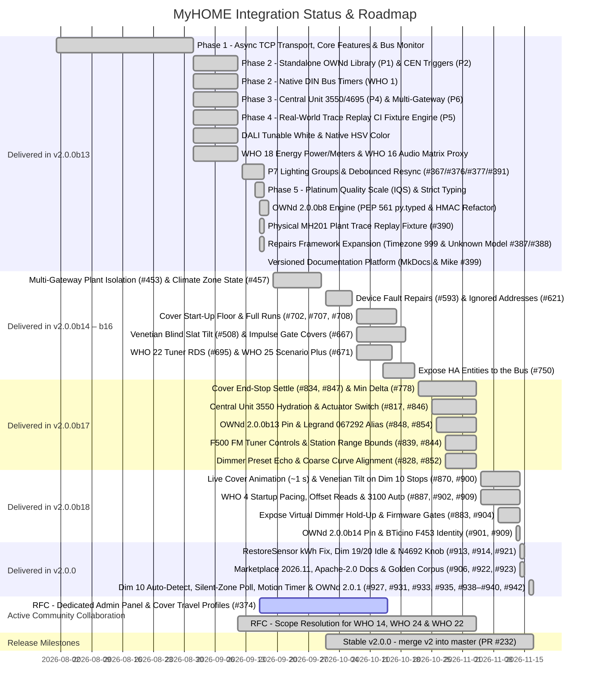
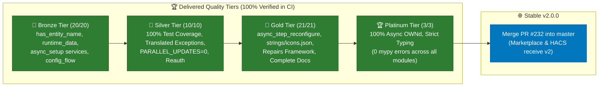

# MyHOME for Home Assistant — Project Roadmap & Community Consultation

Welcome to the development roadmap and community consultation for the **MyHOME for Home Assistant** integration.

Our overarching mission is to provide the most reliable, complete, and high-performance integration between Home Assistant and the BTicino / Legrand SCS OpenWebNet ecosystem. We adhere to strict standards: **zero-latency asynchronous architecture**, **hardware-level protocol fidelity**, **100% automated test coverage**, and **full Home Assistant Core 2025/2026 compatibility**.

---

## 🗺️ Current Delivery Status (v2.0.0 Release Readiness & Platinum IQS)

Through intense community collaboration and engineering, the major architectural milestones originally planned across Phases 1, 2, 3, and 4 have been **consolidated, fully implemented, and validated with 100% statement and branch test coverage** in the **v2.0.0 architecture** (shipped in `2.0.0` on `OWNd==2.0.1`). Furthermore, **Phase 5 (Home Assistant Integration Quality Scale)** has been achieved ahead of schedule, with the integration officially qualifying for the **🏆 Platinum Quality Scale** and strict typing enforced with zero errors across all modules.



---

## 📦 What is Shipped & Operational in v2.0.0

The following table summarizes the completed architectural features and protocol subsystems verified in the current release:

| Priority / Feature | Subsystem | Implementation Status | Highlights |
|---|---|---|---|
| **Cover Live Animation, End-Stop Settle & Min Delta** | WHO=2 | ✅ **Shipped** (#778, #834, #847, #870, #900) | ~1 s interpolated live position during timed runs, full-run settle on `travel_time + 2s`, 0.5 s early cutoff tolerance, `min_position_delta` (1–5%), and Venetian slat-tilt tracking across intermediate `Dimension 10` stops. |
| **Expose HA Entities to the Bus** | Core / WHO=1, 2, 4, 13, 18 | ✅ **Shipped** (#750, #883, #904) | Declarative `expose` engine: virtual WHO 1 / WHO 2 actuators (with `H4652/2` hold-up step-up, retry dedup, and UI action selectors), firmware-gated WHO 4 / WHO 18 virtual probes, and the WHO 13 bus clock. |
| **Venetian Blinds, Impulse Gates & Cover Start-Up Floor** | WHO=2 / WHO=1 | ✅ **Shipped** (#508, #667, #702, #707, #708) | Slat tilt as timed slat pulses (`slat_tilt`, `slat_time`); impulse garage / gate covers on WHO 1 relays with optional safety approval; per-cover `min_motor_pulse`, full runs at 0 % / 100 %, and timed runs ended at the actuator's stop status. |
| **Standalone Protocol Engine (P1)** | Core | ✅ **Shipped** (`OWNd==2.0.1`) | Extracted into an independent, strongly typed Python library on PyPI; PEP 561 `py.typed` compliance, idle command-socket recovery (`OWNd#165`), WHO 4 profile flags (`OWNd#168`, `OWNd#181`), `*4*3100*#0##` central `auto` builder (`OWNd#169`), and WHO 4 `Dimension 19/20` idle codes (`OWNd#174`). |
| **Lighting Groups & General Debounced Resync (P7)** | WHO=1 | ✅ **Shipped** (#367, #376, #377, #391) | Declared groups under `light:` in `myhome.yaml` (`where: '#G'`, optional `members:`) with aggregate status or `assumed_state`; 500 ms debounced sweep with bidirectional echo window and per-address cancellation; truthful event emission and centralized `FrameRouter` integration. |
| **Strict Typing & Platinum Quality Seal** | Core / IQS | ✅ **Shipped** (`quality_scale.yaml`) | 100% compliance across all Bronze, Silver, Gold, and Platinum rules; strict `mypy` typing with 0 errors across all integration modules. |
| **CEN / CEN+ UI Device Triggers (P2)** | WHO=15 / 25 | ✅ **Shipped** | First-class Home Assistant UI device triggers with string-preserved addressing (`"0001"`), gateway MAC isolation, and all 8 press/held/release actions. |
| **Native Hardware Bus Timers** | WHO=1 | ✅ **Shipped** | Offloaded countdown timers on Legrand DIN actuators (F411) via the dedicated `myhome.turn_on_timed` service action (`0.5–918,000` seconds). |
| **Central Unit Coordination (P4)** | WHO=4 | ✅ **Shipped** | Dedicated master coordination for 99-zone Central Unit (`#0`, model 3550) and 4-zone Central Unit (`#0#1`, model 4695). Master Seasonal switches propagate to subordinate zones. |
| **Multi-Gateway Isolation (P6)** | Core / Dispatcher | ✅ **Shipped** | Namespaced event dispatchers (`f"myhome_cen_event_{mac}"`) and device trigger filtering by parent gateway MAC (`via_device`), eliminating cross-talk across multi-gateway plants. |
| **Real-World CI Trace Replay (P5)** | Testing / CI | ✅ **Shipped** | Automated pytest fixture engine (`tests/test_trace_replay.py`) replaying frozen on-wire bus captures (issue #247 MHS1, issue #297 F454, MH200 physical plant, and MH201 physical plant #390) directly against HA state machines. |
| **DALI Tunable White & Dimmers** | WHO=1 | ✅ **Shipped** | DALI DT8 tunable white (Kelvin 2000K–6535K / mireds, Dimension 14), HSV color auto-promotion (Dimension 12), and dimming speed curves. |
| **Fancoil Thermoregulation & Antifreeze Target** | WHO=4 | ✅ **Shipped** (#383) | 3-speed fancoil control (`auto`, `low`, `medium`, `high`) using dimension 11, temperature offset tracking, startup sweeps, and active antifreeze target preservation across sweeps. |
| **Cover Virtual Positioning & Delivery Protection** | WHO=2 | ✅ **Shipped** (#302, #319, #380) | Virtual travel-time positioning, 60s hardware cutoff safety guard, live bus calibration service (`myhome.calibrate_cover`), and delivery failure motion abort preventing phantom position advances. |
| **Sound System 2.0, WHO 22 RDS Tuners & Streaming Proxy** | WHO=16 / 22 | ✅ **Shipped** (#695, #839, #844) | Multi-room matrix amplifier control (`F441`/`F441M` over `WHO = 16`), `F500`/`F500N` FM RDS tuner controls (`media_player`, `number`, `button`) on both `WHO = 22`-only (`MyHomeServer1`, `F461`) and dual-stack gateways, `4#<area>` active-source area tracking, and Dynamic Streaming Proxy (`DecoderPool`) for Music Assistant / Spotify. |
| **Door Entry Locks & Intercom Events** | WHO=6 / 8 | ✅ **Shipped** (#667) | Door lock release entities (`lock.py`, configurable hold pulse and optional PIN confirmation) and video intercom call event triggers. |
| **Energy Management & Metering** | WHO=18 | ✅ **Shipped** | Instantaneous active power (W) and total/daily/monthly energy counters (Wh) wired into Home Assistant Energy Dashboard sensors (`F520` / `F521` / `3522`). |
| **Burglar Alarm** | WHO=5 | ✅ **Shipped** | Armed / disarmed / triggered state (read-only panel), zone 0 synchronization, `myhome_alarm_event` notifications, and optional AUX (`WHO = 9`) arming/disarming bridge for central units (`3485`/`3486`). |
| **Dry Contacts & Technical Alarms** | WHO=25 | ✅ **Shipped** | Dynamic discovery, inverted contact states, and event dispatching for Legrand 3477 binary sensors. |
| **Gateway Session Supervisor & Latency Tuning** | Core / Gateway | ✅ **Shipped** (#378) | Profile-driven `command_session_idle_timeout` to support high-latency or legacy gateway architectures (e.g. MH201, MH200N). |
| **Lovelace Bus Monitor Card** | Frontend | ✅ **Shipped** (`<myhome-openwebnet-bus-monitor>`) | Live scrolling stream, color-coded WHO badges, syntax injector, local timestamp rendering, **`🔴 Start Trace` / `⏹ Stop Trace`** session recording, and 1-click **`📋 Copy Trace`** / **`💾 Export Trace`** diagnostic export. |

---

## 🗳️ Community RFC: How Should We Deal With the Last Remaining Items?

With the foundational architecture and primary subsystems delivered, only a small set of specialized protocol capabilities remains from the original RFC #248 gap analysis.

We invite community members, certified installers, and power users to review the options below and share their input in [**RFC Discussion #248**](https://github.com/orgs/OpenWebNet-HA/discussions/248):

---

### 1. 💡 P7: Lighting Groups & General Sync (`WHO = 1`) — ✅ Resolved & Shipped

#### The Technical Context:
In OpenWebNet, lighting actuators can be triggered individually (`WHERE=10`), by group (`WHERE=#1` through `#255`), by environment/room (`WHERE=room`), or generally across the whole plant (`WHERE=0`).
In ideal installations, actuators broadcast individual status frames (`*1*0*10##`, `*1*0*11##`) after executing a group or general command. However, on older gateways or specific actuator configurations, actuators do **not** emit individual status messages, leaving Home Assistant entities out of sync with the physical lights.

#### Delivered Architecture (PRs #367, #376, #377, #391):
Community consensus and engineering converged on a robust two-tier hybrid approach, fully delivered and validated in **v2.0.0b12**:

1. **Truthful Broadcast Event Dispatching (#367)**: `myhome_group_light_event`, `myhome_area_light_event`, and `myhome_general_light_event` report a truthful `event` — strictly `on`/`off` for knowable WHATs, never firing a false `off` for speed, dimming, or toggle frames.
2. **Declared Groups (#376)**: Groups are declared in `myhome.yaml` directly under `light:` (`where: '#G'`, optional `members:`), co-located with `lock_features` (#364). When `members` is specified, state is derived dynamically from member lights like `light.group`; otherwise, it operates as an `assumed_state` light.
3. **Centralized FrameRouter Integration (#391)**: `MyHOMELightGroup` implements the standardized `FrameRouter` interface (`handle_event`), enforced by type checking in `MyHOMEEntity` and an automated PR checklist.
4. **Bidirectional Debounced Fallback Sweep (#377)**: A group, area, or general command arms a 500 ms debounce window (`RESYNC_DEBOUNCE_S = 0.5`) with per-address cancellation. If individual member statuses echo spontaneously (as confirmed on F461, F429G, F454, and physical MH200 captures), the sweep is cancelled. If individual replies do not arrive within the window, a targeted status sweep (`*#1*#G##` / `*#1*A##`) fires, ensuring complete synchronization without bus congestion.

---

### 2. 🪟 P3: Cover Calibration & Dedicated Administration Panel (`WHO = 2`)

#### The Technical Context:
Home Assistant provides **virtual travel-time positioning** for standard `WHO = 2` covers (calculating percentage open/closed from calibrated opening and closing durations).
Legrand advanced shutter actuators (such as the `067557`, `LN4672M2`, and `F401`) also support native hardware positioning via `Dimension 10` (`*#2*WHERE*10*BS*LEVEL*...##`), reporting `LEVEL = 255` before physical *Push&Learn* end-stop learning has been completed on the actuator.

#### Shipped Foundation:

* **Interactive Live Bus Calibration Engine (#302, #319)**: Built-in `myhome.calibrate_cover` service with automatic stopwatch timing directly from on-wire frames, **Calibrate travel time** (per-cover) and **Calibrate all covers** (gateway-level) configuration buttons (`EntityCategory.CONFIG`), `copied_from` timing sharing across identical shutters, and a 60-second hardware cutoff safety guard.
* **Delivery Failure Motion Abort (#380)**: Immediately stops virtual movement and prevents phantom position advance when a cover frame is rejected or unconfirmed by the gateway.

#### Active Community Collaboration: Dedicated Administration Panel (#374):
Work is actively underway in **PR #374** (by @xtimmy86x, following [Discussion #270](https://github.com/orgs/OpenWebNet-HA/discussions/270)) introducing an experimental administration panel:

* **Asymmetric Travel Profiles**: Configurable independent opening and closing durations per cover.
* **Guided & Batch Calibration**: Guided, automatic, and selected-cover batch calibration workflows with explicit preview and atomic persistence.
* **Integrated Diagnostics & Bus Monitor**: Embedded live trace capture, frame filtering, transmission, and diagnostic export directly inside the administration panel.
* **WHO Category Inventory**: Categorized gateway entity inventory with search and area management.

---

### 3. 🔒 WHO 14: Actuator Maintenance Locks & Relay Cycle Counters — ✅ Community Consensus

#### The Technical Context:
OpenWebNet WHO 14 handles actuator diagnostics, relay cycle counters, and hardware maintenance locks (preventing physical buttons from toggling a relay during maintenance or security states).

#### Community Resolution:

* **Diagnostic Buttons Preserved (#353)**: Actuator lock and unlock controls are exposed as configuration buttons (`button.py`) under `EntityCategory.CONFIG`, allowing maintenance commands without creating cluttering lock entities.
* **Bus Monitor Visibility**: WHO 14 frames remain fully visible, parsed, and color-coded in the Lovelace Bus Monitor card for diagnostic troubleshooting.

---

### 4. 🏢 WHO 24: Legrand Commercial Lighting Management Room Controllers — ✅ Resolved Scope

#### The Technical Context:
WHO 24 is designed for commercial Legrand Lighting Management controllers (**BMNE500**, **BMview**, **002645**) used in office buildings and schools. Residential MyHOME plants almost universally use standard WHO=1 lighting and DALI gateways (F429).

#### Community Resolution:

* **Scope Deferred**: WHO 24 is deferred as an optional standalone extension, keeping core integration scope focused on residential and commercial SCS bus systems.

---

### 5. 🎵 WHO 22: Sound Diffusion (`bt_multi`), FM RDS Tuners & Active-Source Tracking — ✅ Resolved & Shipped

#### The Technical Context:
In OpenWebNet (`WHO_22.pdf` v1.1.0), `WHO = 22` (*Diffusione Sonora Avanzata*, implemented by `bt_multi` in gateway firmware) is the modern multi-room sound diffusion protocol — **not** an obsolete legacy dialect. Modern gateways (`MyHomeServer1`, `F459`, `F460`, `F461`) implement **only `WHO = 22`** and drop `WHO = 16` frames on the command session, whereas dual-stack gateways (`MH200N`, `MH202`, `F454`, `H4890`, `H/L4684` FW ≥ `6.0.0`) bridge both `WHO = 16` and `WHO = 22`.

#### Delivered Architecture (PRs #695, #839, #844):

* **First-Class FM RDS Tuner Entities (`WHO = 16` & `WHO = 22`)**: Full hardware support for declared `F500` / `F500N` / `F500COAX` RDS stereo tuners across `media_player` (live RDS station name, radio text, MHz readout, preset selection via Media Browser & source list, and seek controls), `number` (`87.50–108.00 MHz` manual frequency tuning in `0.05 MHz` / `50 kHz` steps), and `button` (hardware `Seek up` and `Seek down`), plus dedicated `myhome.tuner_seek_up`, `myhome.tuner_seek_down`, `myhome.tuner_set_frequency`, and `myhome.tuner_store_station` service actions.
* **`WHO = 22`-Only & Dual-Stack Gateway Support**: Automatic protocol selection per gateway profile so `F500` / `F500N` FM RDS tuners (`2#S` / `5#2#S`) operate natively on `WHO = 22`-only gateways (`MyHomeServer1`, `F461`) as well as dual-stack gateways (`MH200N`, `MH202`, `F454`, `H4890`, `H/L4684` FW ≥ `6.0.0`), while room amplifier zones (`01`–`99` / `1ES` on `F441` / `F441M`) operate over `WHO = 16` (see [Known Limitations](https://openwebnet-ha.github.io/MyHOME/latest/configuration/known_limitations/) for shared-bus delegation when pairing a `WHO = 22`-only gateway with `WHO = 16` room amplifiers).
* **Active-Source Area Tracking & Streaming Proxy Coexistence**: Dual-stack gateways track `4#<area>` active-source broadcasts (`*22*...*4#<area>##` / `*#22*4#<area>*...##`) alongside the `DecoderPool` **Dynamic Streaming Proxy**, allowing digital streams from **Music Assistant**, **Spotify Connect**, and **AirPlay** to coexist cleanly with physical `F500` tuners and wall amplifiers.

---

## 🏆 Phase 5 Achieved: Home Assistant Platinum Quality Scale

Originally planned as an extended post-beta milestone, all requirements for the **Home Assistant Integration Quality Scale** have been **fully implemented and verified ahead of schedule**, elevating MyHOME directly to the **🏆 Platinum Quality Scale** ([Home Assistant Integration Quality Scale](https://developers.home-assistant.io/docs/core/integration-quality-scale/)).

Under Home Assistant Core architecture, achieving Platinum requires 100% strict compliance across all Bronze, Silver, and Gold criteria without exception.

### 📊 Quality Scale Compliance & Architecture



### 📋 Detailed Quality Scale Audit Summary

#### 1. 🥉 Bronze Architectural Alignments — ✅ 100% Complete (20/20)

* **`has-entity-name = True`**: Fully implemented across all entity platforms (`MyHOMEEntity` in `custom_components/myhome/myhome_device.py`). Primary entities inherit device naming (`_attr_name = None`), and manual `entity_id` assignment has been eliminated in favor of core registry naming (`tests/test_entity_naming.py`).
* **`runtime-data`**: Replaced all legacy `hass.data[DOMAIN]` global state with typed `ConfigEntry.runtime_data` (`MyHOMERuntimeData` in `data.py`), enforced statically by `scripts/verify_ha_standards.py`.
* **`action-setup`**: Service action registrations (`sync_time`, `send_message`, `sweep_bus`, `turn_on_timed`, etc.) are centralized in `services.py` and registered once in `async_setup`, preventing listener teardown during entry reloads.

#### 2. 🥈 Silver Robustness & Quality Hardening — ✅ 100% Complete (10/10)

* **`test-coverage` (100.0% Strict Statement Coverage)**: Surpasses the core >95% requirement. MyHOME enforces strict 100.0% statement coverage across all integration modules (6,554 automated tests passing with zero misses, guarded by `tests/test_coverage_enforcer.py` and CI).
* **`action-exceptions`**: Service actions validate all inputs and raise `homeassistant.exceptions.ServiceValidationError` or `HomeAssistantError` mapped directly to localized translation keys under `exceptions` in `strings.json`.
* **`parallel-updates`**: Declares explicit `PARALLEL_UPDATES = 0` across all 11 platform modules (`light.py`, `switch.py`, `cover.py`, `climate.py`, `sensor.py`, `binary_sensor.py`, `media_player.py`, `button.py`, `number.py`, `alarm_control_panel.py`, `lock.py`) for non-blocking local push stream processing.

#### 3. 🥇 Gold User Experience & Framework Features — ✅ 100% Complete (21/21)

* **`reconfiguration-flow`**: Supports `async_step_reconfigure` in `config_flow.py` (**Reconfigure**) to update gateway IP address (`host`), `port`, or `password` in place, while **Configure** (Options Flow) updates the gateway hardware `model` and runtime options without deleting devices or breaking entity IDs.
* **`strings.json` & `icon-translations`**: `custom_components/myhome/strings.json` and `icons.json` serve as the canonical source of truth for all entity states, configuration forms, device classes, and service actions.
* **`repair-issues`**: Active integration of Home Assistant's Repairs framework (`async_create_issue`):
    - `gateway_identity_mismatch` & `gateway_identity_corrected`: Proactively informs users if configured model conflicts with WHO=13 hardware telemetry.
    - `unconfigured_timezone` (PR #387): Automatically flags legacy gateway timezone sentinel `999` with remediation guidance.
    - `unknown_gateway_model` (PR #388): Captures unmapped WHO=13 hardware codes (`999`) and directs users to diagnostic trace submission.
* **Complete Core Documentation Suite**: Comprehensive Gold standard documentation across `docs/configuration/`, `docs/getting-started/`, `docs/diagnostics/`, and `docs/architecture/`.
* **`quality_scale.yaml`**: Official compliance manifest actively tracked at `custom_components/myhome/quality_scale.yaml` and verified by `scripts/quality_scale_report.py`.

#### 4. 🏆 Platinum Engineering Tier — ✅ 100% Complete (3/3)

* **`async-dependency`**: The underlying `OWNd` protocol engine (`OWNd==2.0.1`, pinned in `manifest.json`) is a 100% non-blocking asyncio library with zero synchronous blocking socket calls.
* **`inject-websession`**: Formally exempt (all communication operates over raw OpenWebNet binary/text TCP streams; no HTTP websession required).
* **`strict-typing`**: Enforces `mypy --strict` with **0 errors across all integration modules**. Cascading type errors were eliminated alongside `OWNd`'s PEP 561 `py.typed` marker (PR #393), guarded in CI by `scripts/typing_ratchet.py`.

#### 5. 🌐 Release Status: Stable v2.0.0

* **Branding Assets (`brands`)**: Already in place. Local brand assets (`icon.png`, `icon@2x.png`, `logo.png`, `logo@2x.png`) are bundled in `custom_components/myhome/brand/` for Home Assistant 2026.8+ and the Home Assistant Marketplace (2026.11+), and the MyHOME icon and logo were also merged into `home-assistant/brands` in [`#2052`](https://github.com/home-assistant/brands/pull/2052) (2020-11-30, for the original integration); nothing is pending.
* **PR #232 (`v2-phase1-architecture` → `master`)**: The pull request that brings v2 to `master` inside this repository, so that Home Assistant Marketplace (2026.11+) and HACS (`< 2026.11`) users receive it as a stable release; it is not a Home Assistant core submission. It is mergeable and awaiting review. Prepared for the `v2.0.0` stable release on `OWNd==2.0.1`; requires Home Assistant 2026.8 or newer (Python 3.14).

---

## 📊 Real-World Trace Coverage Schematic (What We Have vs. What We Need)

To eliminate regression risks and verify complex timing constraints, our **Trace Replay Engine** (`tests/test_trace_replay.py`) replays authentic on-wire captures against the Home Assistant integration.

Below is the definitive schematic of which gateways and subsystems are **already covered by real-world captures in CI**, and where we **still need community recordings**.

### 🗺️ System Coverage Overview

```mermaid
graph TD
    subgraph Gateways["🏛️ Gateways & Transports"]
        GW_MHS1["🟢 MyHomeServer1<br/>(52 captures · 8,342 rx)"]
        GW_F454["🟢 F454<br/>(23 captures · 4,447 rx)"]
        GW_F455["🟢 F455<br/>(14 captures · 812 rx)"]
        GW_F459["🟢 F459<br/>(1 capture · 898 rx)"]
        GW_F461["🟢 F461<br/>(23 captures · 3,212 rx)"]
        GW_MH202["🟢 MH202<br/>(9 captures · 672 rx)"]
        GW_MH201["🟢 MH201<br/>(10 captures · 976 rx)"]
        GW_MH200N["🟢 MH200N<br/>(16 captures · 1,664 rx)"]
        GW_MH200["🟢 MH200<br/>(13 captures · 1,341 rx)"]
        GW_F453["🟢 F452 / F453 / F453AV<br/>(10 captures · 1,065 rx)"]
        GW_H4890["🟢 H4890 / AM4890 / 067292<br/>(5 captures · 983 rx)"]
        GW_H4684["🟢 H4684 / H/L4684<br/>(11 captures · 1,179 rx)"]
        GW_3578["🔴 Legrand 3578<br/>(Deferred to v2.1+ · #879)"]
    end

    subgraph Subsystems["⚙️ Protocol Subsystems & Edge Scenarios"]
        SUB_LIGHT["🟢 Lighting & Dimmers (WHO 1)<br/>(5,244 rx · 86 captures)"]
        SUB_DALI["🟢 DALI DT8 & HSV (WHO 1)<br/>(18 rx · 2 captures)"]
        SUB_TIMER["🟢 DIN Bus Timers (WHO 1)<br/>(8 rx · 5 captures)"]
        SUB_GRP["🟢 Lighting Groups (WHO 1)<br/>(27 rx · 10 captures)"]
        SUB_COV_V["🟢 Covers Timed & Calibrated (WHO 2)<br/>(1,419 rx · 57 captures)"]
        SUB_COV_H["🟢 Covers Dim 10 / 11 (WHO 2)<br/>(495 rx · 25 captures)"]
        SUB_COV_255["🟡 Uncalibrated Dim 10=255 (WHO 2)<br/>(Unit tests only)"]
        SUB_THERMO_ZONES["🟢 Zone Thermostats & Probes (WHO 4)<br/>(9,904 rx · 84 captures)"]
        SUB_CU3550["🟢 Central Unit 3550 (WHO 4)<br/>(286 rx · 22 captures)"]
        SUB_CU4695["🔴 Central Unit 4695 (WHO 4)<br/>(Physical capture needed)"]
        SUB_FANCOIL["🟢 Fancoils Dim 11/20 (WHO 4)<br/>(445 rx · 28 captures)"]
        SUB_ALARM["🟢 Burglar Alarm (WHO 5)<br/>(273 rx · 12 captures)"]
        SUB_DOOR["🟢 Door Entry (WHO 6/8)<br/>(42 rx · 5 captures)"]
        SUB_DRY["🟢 AUX & Dry Contacts (WHO 9/25)<br/>(210 rx · 15 captures)"]
        SUB_CEN["🟢 CEN / CEN+ Triggers (WHO 15/25)<br/>(95 rx · 20 captures)"]
        SUB_SCENARIOS["🟢 Scenarios (WHO 0/17)<br/>(33 rx · 7 captures)"]
        SUB_LOCK14["🟢 Actuator Locks (WHO 14)<br/>(24 rx · 6 captures)"]
        SUB_WHO16["🟢 Audio Matrix (WHO 16)<br/>(431 rx · 22 captures)"]
        SUB_WHO22["🟢 Sound Diffusion & RDS (WHO 22)<br/>(404 rx · 18 captures)"]
        SUB_ENERGY["🟢 Energy Metering (WHO 18)<br/>(1,425 rx · 27 captures)"]
        SUB_DIAG["🟢 Gateway Identity (WHO 13/1013)<br/>(1,204 rx · 80 captures)"]
        SUB_ROUTER["🟢 F422 Cross-Bus (#4#bus)<br/>(420 rx · 15 captures)"]
    end

    subgraph Engine["🧪 CI Replay & Regression Suite"]
        HARNESS["tests/test_trace_replay.py & fixture tests<br/>(Deterministic On-Wire Replay)"]
    end

    GW_MHS1 --> HARNESS
    GW_F454 --> HARNESS
    GW_F455 --> HARNESS
    GW_F459 --> HARNESS
    GW_F461 --> HARNESS
    GW_MH202 --> HARNESS
    GW_MH201 --> HARNESS
    GW_MH200N --> HARNESS
    GW_MH200 --> HARNESS
    GW_F453 --> HARNESS
    GW_H4890 --> HARNESS
    GW_H4684 --> HARNESS
    SUB_LIGHT --> HARNESS
    SUB_DALI --> HARNESS
    SUB_TIMER --> HARNESS
    SUB_GRP --> HARNESS
    SUB_COV_V --> HARNESS
    SUB_COV_H --> HARNESS
    SUB_THERMO_ZONES --> HARNESS
    SUB_CU3550 --> HARNESS
    SUB_FANCOIL --> HARNESS
    SUB_ALARM --> HARNESS
    SUB_DOOR --> HARNESS
    SUB_DRY --> HARNESS
    SUB_CEN --> HARNESS
    SUB_SCENARIOS --> HARNESS
    SUB_LOCK14 --> HARNESS
    SUB_WHO16 --> HARNESS
    SUB_WHO22 --> HARNESS
    SUB_ENERGY --> HARNESS
    SUB_DIAG --> HARNESS
    SUB_ROUTER --> HARNESS

    classDef covered fill:#2e7d32,stroke:#1b5e20,color:#ffffff;
    classDef partial fill:#f57f17,stroke:#e65100,color:#ffffff;
    classDef needed fill:#c62828,stroke:#b71c1c,color:#ffffff;
    class GW_MHS1,GW_F454,GW_F455,GW_F459,GW_F461,GW_MH202,GW_MH201,GW_MH200N,GW_MH200,GW_F453,GW_H4890,GW_H4684,SUB_LIGHT,SUB_DALI,SUB_TIMER,SUB_GRP,SUB_COV_V,SUB_COV_H,SUB_THERMO_ZONES,SUB_CU3550,SUB_FANCOIL,SUB_ALARM,SUB_DOOR,SUB_DRY,SUB_CEN,SUB_SCENARIOS,SUB_LOCK14,SUB_WHO16,SUB_WHO22,SUB_ENERGY,SUB_DIAG,SUB_ROUTER covered;
    class SUB_COV_255 partial;
    class GW_3578,SUB_CU4695 needed;
```

<!-- ROADMAP_COVERAGE_MERMAID_START -->

<!-- ROADMAP_COVERAGE_MERMAID_END -->

---

### 🏛️ Table 1: Gateway Models & Hardware Transports

<!-- ROADMAP_GATEWAY_TABLE_START -->
| Gateway Model | Status | Current Evidence / Fixture | Community Trace Needed / Target Scenario |
| :--- | :--- | :--- | :--- |
| **MyHomeServer1 (MHS1)** | 🟢 **Covered** | 52 physical captures (8,342 `rx` frames; `WHO = 1, 2, 4, 7, 8, 9, 13, 14, 15, 18, 22, 25, 1000, 1001, 1013`) — e.g. `tests/fixtures/traces/issue_466/`, `tests/fixtures/traces/who4_four_gateways_2026_11_18/` | *None needed — cloud/local hybrid gateway plant active in CI.* |
| **F454** | 🟢 **Covered** | 23 physical captures (4,447 `rx` frames; `WHO = 0, 1, 2, 4, 5, 9, 13, 14, 18, 25, 1013`) — e.g. `tests/fixtures/traces/issue_429/`, `tests/fixtures/traces/issue_466/` | *None needed — high-speed multi-session IP webserver active in CI.* |
| **F455** | 🟢 **Covered** | 14 physical captures (812 `rx` frames; `WHO = 1, 2, 4, 13, 25, 1001, 1013`) — e.g. `tests/fixtures/traces/issue_466/`, `tests/fixtures/traces/central_restore_3100_live_2026-11-12/` | *None needed — single-bus DIN IP gateway active in CI.* |
| **F459** | 🟢 **Covered** | 1 physical capture (898 `rx` frames; `WHO = 1, 2, 4, 13, 1013`) — e.g. `tests/fixtures/traces/issue_466/` | *None needed — WHO 1013 code 65 & WHO 4 capture active in CI.* |
| **F461 Web Server** | 🟢 **Covered** | 23 physical captures (3,212 `rx` frames; `WHO = 1, 2, 4, 13, 14, 1001, 1013`) — e.g. `tests/fixtures/traces/f461_live_2026-10-24/`, `tests/fixtures/traces/f461_live_2026-10-15/` | *None needed — DIN Ethernet Web Server (DALI DT8 & fancoils) active in CI.* |
| **MH202** | 🟢 **Covered** | 9 physical captures (672 `rx` frames; `WHO = 1, 2, 4, 5, 6, 8, 9, 13, 14, 16, 18, 22, 25, 1013`) — e.g. `tests/fixtures/traces/issue_466/`, `tests/fixtures/traces/mh202_sound_intercom_ducking/` | *None needed — modern scenario programmer plant active in CI.* |
| **MH201** | 🟢 **Covered** | 10 physical captures (976 `rx` frames; `WHO = 0, 1, 2, 4, 13, 15, 18, 25`) — e.g. `tests/fixtures/traces/issue_466/`, `tests/fixtures/traces/mh201-fresh-discovery-20260930.log` | *None needed — single-worker scenario programmer plant active in CI.* |
| **MH200N** | 🟢 **Covered** | 16 physical captures (1,664 `rx` frames; `WHO = 0, 1, 2, 4, 5, 9, 13, 15, 16, 17, 18, 22, 25, 1001, 1013, 1022`) — e.g. `tests/fixtures/traces/issue_466/`, `tests/fixtures/traces/f500_tuner/` | *None needed — second-generation scenario programmer active in CI.* |
| **MH200** *(Legacy)* | 🟢 **Covered** | 13 physical captures (1,341 `rx` frames; `WHO = 1, 2, 5, 6, 8, 9, 13, 16, 17, 1001, 1013`) — e.g. `tests/fixtures/traces/issue_466/`, `tests/fixtures/traces/mh200_sound_f441m/` | *None needed — legacy single-session plant & F441M audio active in CI.* |
| **F452 / F453 / F453AV** | 🟢 **Covered** | Traced `F453AV, F453`: 10 physical captures (1,065 `rx` frames; `WHO = 1, 2, 4, 5, 13, 25, 1001, 1013`) — e.g. `tests/fixtures/traces/issue_619/`, `tests/fixtures/traces/discussion_770_f453_n4692/` | *Family covered by physical `F453AV` & `F453` captures; optional legacy `F452 / F452V` captures welcomed.* |
| **H4890 / AM4890 / 067292** | 🟢 **Covered** | Traced `H4890, 067292`: 5 physical captures (983 `rx` frames; `WHO = 1, 2, 4, 5, 9, 13, 16, 18, 22, 25`) — e.g. `tests/fixtures/traces/issue_832/`, `tests/fixtures/traces/issue_466/` | *None needed — 3.5" touchscreen IP gateways (BTicino & Legrand) active in CI.* |
| **H4684 / H/L4684** | 🟢 **Covered** | Traced `H/L4684`: 11 physical captures (1,179 `rx` frames; `WHO = 1, 2, 3, 4, 5, 6, 9, 13, 16, 22, 1001, 1004`) — e.g. `tests/fixtures/traces/issue_466/` | *None needed — colour touchscreen IP gateway (FW 2.x & 6.x) active in CI.* |
| **Legrand 3578 USB/Serial** | 🔴 **Deferred (v2.1+)** | Deferred out of `v2.0.0` ([Discussion #879](https://github.com/orgs/OpenWebNet-HA/discussions/879)) | **Hardware tester & raw serial stream**: Active tester + raw byte capture ([Issue #466](https://github.com/OpenWebNet-HA/MyHOME/issues/466)) from a physical OpenZigBee installation (`WHERE=<id>#9`). |

*Table 1 is automatically generated and verified from physical bus captures in `tests/fixtures/` and supported models in `custom_components/myhome/const.py` by `scripts/sync_documentation.py`.*
<!-- ROADMAP_GATEWAY_TABLE_END -->

---

### ⚙️ Table 2: Subsystems, Dimensions & Edge Scenarios

<!-- ROADMAP_SUBSYSTEM_TABLE_START -->
| Subsystem & Domain | Status | Current Evidence / Fixture | Community Trace Needed / Target Scenario |
| :--- | :--- | :--- | :--- |
| **Lighting (WHO = 1) — Relays & Dimmers** | 🟢 **Covered** | 5,244 physical `rx` frames across 86 captures on 13 gateway models — e.g. `tests/fixtures/traces/issue_466/`, `tests/fixtures/traces/issue_629/` | *Baseline covered across standard, 4-digit, and F418/F418U2 dimmers.* |
| **Lighting (WHO = 1) — DALI Tunable White & HSV Color** | 🟢 **Covered** | 18 physical `rx` frames across 2 captures on 1 gateway model — e.g. `tests/fixtures/plants/issue_288_f461_dali_dt8/`, `tests/fixtures/traces/issue_466/` | *Baseline covered (`Dimension 12` HSV & `Dimension 14` Kelvin/mireds).* |
| **Lighting (WHO = 1) — Native DIN Timers** | 🟢 **Covered** | 8 physical `rx` frames across 5 captures on 3 gateway models — e.g. `tests/fixtures/plants/issue_311_f454/`, `tests/fixtures/traces/f461_live_2026-10-15/` | *Preset temporization & `Dimension 2` replies covered; optional mid-countdown `*#1*WHERE*2*H*M*S##` (`H/M/S > 0`) trace welcomed.* |
| **Lighting (WHO = 1) — Groups & General Broadcasts (P7)** | 🟢 **Covered** | 27 physical `rx` frames across 10 captures on 6 gateway models — e.g. `tests/fixtures/traces/issue_466/`, `tests/fixtures/traces/f461_live_2026-10-15/` | *None needed — group (`#G`) and general (`WHERE=0`) resync engine active in CI.* |
| **Covers (WHO = 2) — Travel-Time Positioning & On-Bus Calibration** | 🟢 **Covered** | 1,419 physical `rx` frames across 57 captures on 13 gateway models — e.g. `tests/fixtures/traces/issue_466/`, `tests/fixtures/traces/discussion_856/`; plus 23 calibrated `cover_travel_times` profiles in `tests/fixtures/traces/discussion_856/`, `tests/fixtures/traces/mh200_sound_f441m/` | *Baseline covered (stopwatch `myhome.calibrate_cover` runs, `cover_travel_times` profiles, and timed slat pulses active in CI).* |
| **Covers (WHO = 2) — Advanced Position (`Dim 10 / 11`)** | 🟢 **Covered** | 495 physical `rx` frames across 25 captures on 6 gateway models — e.g. `tests/fixtures/traces/issue_466/`, `tests/fixtures/traces/discussion_770_f454_f401/` | *Baseline covered (`F401` / `LN4661M2` percentage position; the slat angle is not on the bus).* |
| **Covers (WHO = 2) — Uncalibrated Hardware Sentinel (`Dim 10` `LEVEL=255`)** | 🟡 **Synthetic** | Unit tests for `*#2*WHERE*10*BS*255*...##` in `tests/test_cover.py` (0 physical `LEVEL=255` `rx` frames in `tests/fixtures/`) | **Uncalibrated actuator trace**: Bus capture of an uncalibrated `F401`, `LN4672M2`, or `067557` reporting `*#2*WHERE*10*BS*255*...##` prior to *Push&Learn* end-stop learning. |
| **Thermoregulation (WHO = 4) — Zone Thermostats, Probes & Humidity** | 🟢 **Covered** | 9,904 physical `rx` frames across 84 captures on 13 gateway models — e.g. `tests/fixtures/traces/issue_466/`, `tests/fixtures/traces/issue_429/` | *Baseline covered (zone temperature `Dim 0`, setpoints `Dim 12/14`, knob offsets `Dim 13` & `Dim 60` humidity).* |
| **Thermoregulation (WHO = 4) — 99-Zone Central Unit 3550 (`#0`)** | 🟢 **Covered** | 286 physical `rx` frames across 22 captures on 8 gateway models — e.g. `tests/fixtures/traces/central_restore_3100_live_2026-11-12/`, `tests/fixtures/traces/issue_466/` | *Baseline covered (`#0` master modes, `*4*3100*#0##` auto restore, & zone sync).* |
| **Thermoregulation (WHO = 4) — 4-Zone Central Unit 4695 (`#0#1`)** | 🔴 **Needed** | Synthetic unit tests in `tests/test_climate.py` only (0 inbound `#0#1` `rx` frames in `tests/fixtures/`) | **4-zone central unit trace**: Physical capture from a plant running a 4-zone `4695` / `HD4695` (`#0#1`) central unit. |
| **Thermoregulation (WHO = 4) — Fancoils (`Dim 11 / 20`)** | 🟢 **Covered** | 445 physical `rx` frames across 28 captures on 4 gateway models — e.g. `tests/fixtures/traces/issue_466/`, `tests/fixtures/traces/f461_live_2026-10-15/` | *Baseline covered (`Dimension 11` fan speeds & `Dimension 20` fan-coil states `5`–`8`).* |
| **Burglar Alarm (WHO = 5)** | 🟢 **Covered** | 273 physical `rx` frames across 12 captures on 7 gateway models — e.g. `tests/fixtures/traces/issue_466/`, `tests/fixtures/plants/issue_311_f454/` | *Baseline covered (physical `3486` / `MH202` partition & zone captures active in CI).* |
| **Door Entry & Intercom Locks (WHO = 6 / 8)** | 🟢 **Covered** | 42 physical `rx` frames across 5 captures on 4 gateway models — e.g. `tests/fixtures/traces/issue_466/`, `tests/fixtures/traces/mh202_sound_intercom_ducking/` | *Baseline covered (door lock release & video intercom call events active in CI).* |
| **AUX & Dry Contacts (WHO = 9 / 25)** | 🟢 **Covered** | 210 physical `rx` frames across 15 captures on 9 gateway models — e.g. `tests/fixtures/traces/issue_466/`, `tests/fixtures/traces/mh202_sound_intercom_ducking/` | *Baseline covered (`WHO = 9` auxiliary channels & `3477` / `F428` contact sensors).* |
| **CEN / CEN+ Pushbuttons & Rotary Triggers (WHO = 15 / 25)** | 🟢 **Covered** | 95 physical `rx` frames across 20 captures on 6 gateway models — e.g. `tests/fixtures/traces/issue_466/`, `tests/fixtures/traces/issue_434/` | *Baseline covered (short, long-press, repeat & release active in CI); a `WHO = 25` rotary capture (`WHAT = 25..28`) is welcome.* |
| **Scenarios & Schedulers (WHO = 0 / 17)** | 🟢 **Covered** | 33 physical `rx` frames across 7 captures on 3 gateway models — e.g. `tests/fixtures/traces/issue_466/`, `tests/fixtures/traces/f500_tuner/` | *Baseline covered (`WHO = 0` activation on an F454, `WHO = 17` frames on MH200 / MH200N).* |
| **Actuator Maintenance Locks (WHO = 14)** | 🟢 **Covered** | 24 physical `rx` frames across 6 captures on 4 gateway models — e.g. `tests/fixtures/plants/issue_247_myhomeserver1/`, `tests/fixtures/traces/f461_who14_live_2026-10-18/` | *Baseline covered (hardware pushbutton lock/unlock status frames active in CI).* |
| **Sound System (WHO = 16) — Matrix & Streaming Proxy** | 🟢 **Covered** | 431 physical `rx` frames across 22 captures on 5 gateway models — e.g. `tests/fixtures/traces/issue_466/`, `tests/fixtures/traces/mh200_sound_f441m/` | *Baseline covered (`F441` / `F441M` matrix routing, group takeover & ducking).* |
| **Sound Diffusion (WHO = 22) — FM RDS Tuners & Active-Source Sync** | 🟢 **Covered** | 404 physical `rx` frames across 18 captures on 5 gateway models — e.g. `tests/fixtures/traces/issue_466/`, `tests/fixtures/traces/f500_tuner/` | *Baseline covered (`F500` / `F500N` FM RDS tuners on `WHO = 22`-only & dual-stack gateways, `4#<area>` active-source tracking, and `H4562` `WHO = 22` zone captures).* |
| **Energy Management & Metering (WHO = 18)** | 🟢 **Covered** | 1,425 physical `rx` frames across 27 captures on 6 gateway models — e.g. `tests/fixtures/traces/issue_466/`, `tests/fixtures/traces/issue_907/` | *Baseline covered (`F520` / `F521` / `3522` active power `W` and total/daily/monthly `Wh` energy counters).* |
| **Gateway Clock, Identity & Diagnostics (WHO = 13 / 1001–1022)** | 🟢 **Covered** | 1,204 physical `rx` frames across 80 captures on 13 gateway models — e.g. `tests/fixtures/traces/issue_466/`, `tests/fixtures/traces/mh200_sound_f441m/` | *Baseline covered (`WHO = 13` device type/firmware/clock & `WHO = 1013` `OBJECT_MODEL`).* |
| **F422 Cross-Bus Router (`#4#<bus>`)** | 🟢 **Covered** | 420 physical `rx` frames across 15 captures on 4 gateway models — e.g. `tests/fixtures/traces/issue_466/`, `tests/fixtures/plants/issue_288_f461_dali_dt8/` | *None needed — physical F422 local-bus routing (`#4#01`, `#4#02`, ...) active in CI.* |

*Table 2 is automatically generated and verified from inbound (`rx`) OpenWebNet frames and calibration bundles in `tests/fixtures/` by `scripts/sync_documentation.py`.*
<!-- ROADMAP_SUBSYSTEM_TABLE_END -->

---

### 📋 Dual-Track Guide: How Community Testers Can Submit a Trace

We offer **two simple ways** to contribute real-world bus traces, tailored to your technical setup:

#### 🏷️ Track A: Zero-CLI via Home Assistant UI (Fastest & Easiest)
Ideal for standard users running Home Assistant with the MyHOME integration:

1. **Sweep the Bus**: In Home Assistant, go to **Developer Tools** > **Services** and call `myhome.sweep_bus` (or trigger it from the Lovelace Bus Monitor Card). This actively queries all lighting, cover, HVAC, and gateway diagnostic states in under 3 seconds.
2. **Download Diagnostics**: Navigate to **Settings** > **Devices & Services** > **MyHOME** > click the three dots (`⋮`) > **Download diagnostics** (or click **`💾 Export Trace`** / **`📋 Copy Trace`** on the Bus Monitor card).
3. **Submit**: Attach the downloaded `.json` file to [**RFC Discussion #248**](https://github.com/orgs/OpenWebNet-HA/discussions/248) or open a GitHub Issue.
4. *Privacy Guarantee*: Home Assistant and MyHOME automatically redact all passwords, authentication tokens, and private credentials before exporting.

#### 💻 Track B: Standalone Python Tool (Test Benches & Integrators)
Ideal for installers, bench testers, and developers testing isolated gateways without Home Assistant installed:

1. **Run the Trace Recorder**:
    ```bash
    python scripts/record_gateway_trace.py --host 192.0.2.35 --password 12345 --model MH202
    ```
2. **Active Sweep & Listen**: The script automatically executes the diagnostic status sweep, listens for ambient button presses or scenario bursts, and scrubs sensitive credentials.
3. **Drop & Commit**: The tool writes a complete ready-to-test fixture folder in `tests/fixtures/plants/<model>_plant/`.
4. **Instant CI Verification**: Run `pytest tests/test_trace_replay.py` — our parameterized test runner automatically discovers and tests your plant with zero additional test code required! Submit a Pull Request.

---

## 💬 How to Participate

Please share your feedback, real-world bus captures, and advice in our GitHub discussions:

👉 **[User Manual & Documentation](https://openwebnet-ha.github.io/MyHOME/)**  
👉 **[Join the Community Discussion on RFC #248](https://github.com/orgs/OpenWebNet-HA/discussions/248)**  
👉 **[Report Issues or Submit Bus Traces](https://github.com/OpenWebNet-HA/MyHOME/issues)**
