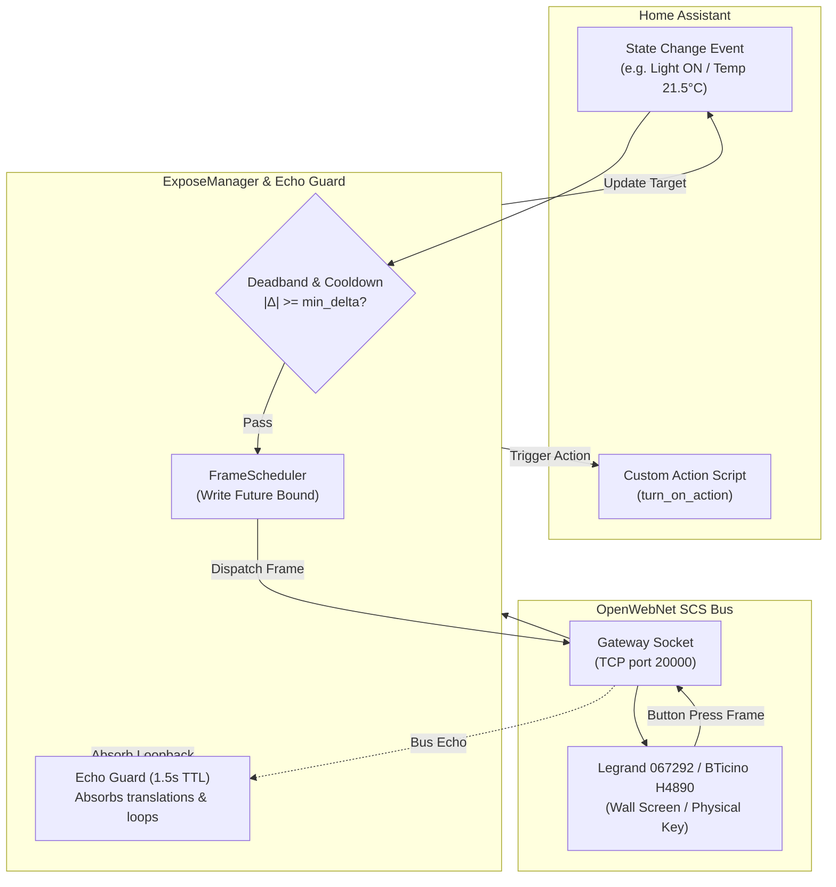

# Exposing Home Assistant Entities & Clock to SCS Bus

The **Expose to Bus** engine allows Home Assistant to project external smart home devices, sensors, energy meters, and the system clock directly onto the Legrand / BTicino OpenWebNet SCS bus on unused addresses.

By emulating virtual OpenWebNet devices, physical wall controls, touchscreens (such as the Legrand `067292`, BTicino `H4890`, `LN4890`, `AM4890`, or `10"` touchscreens), and bus supervisors can interact with non-MyHOME devices (e.g. Philips Hue, Zigbee/Matter lamps, Sonos players, Somfy blinds, Shelly relays, and ESPHome sensors) as if they were native SCS hardware.

---

## 🌟 Common Use Cases

1. **Touchscreen Control of Non-SCS Devices (`WHO = 1` & `WHO = 2`)**:
   Tap an icon or slider on a Legrand `067292` or BTicino `H4890` wall screen to control a Zigbee, Matter, or Wi-Fi device in Home Assistant. Changes made in Home Assistant or voice assistants instantly update the status icon and LED on the wall screen.
2. **Unpopulated Physical Wall Switches (`WHO = 1`)**:
   Use an unused rocker on an `H4652/2` or `K4652M2` physical wall control configured as a point-to-point light (`WHO = 1`) to toggle a TV, media player, or smart bulb with full LED status feedback.
3. **Virtual Temperature Probes (`WHO = 4`)**:
   Publish an outdoor weather service temperature, Zigbee room sensor, or ESPHome probe onto an SCS probe address (`DIMENSION 0`), allowing wall screens and thermostats to display real-time temperatures on their Thermoregulation pages.
4. **Virtual Energy & Power Meters (`WHO = 18`)**:
   Publish live solar inverter generation, battery power, or grid smart-meter metrics onto SCS energy addresses (`DIMENSION 113` for active power in Watts; `DIMENSION 51..54` for totalizers in Wh), displaying live consumption on wall screens.
5. **Bus Clock & Calendar Synchronization (`WHO = 13`)**:
   Keep all wall screens, thermostats, and chronothermostats on the SCS bus synchronized to Home Assistant's local time, date, and daylight saving time (DST).

---

## 🛠️ How to Configure

The integration supports two methods for configuring exposed bindings: **UI Config Subentries** (recommended) and **Declarative YAML** (`myhome.yaml`).

### Method 1: Home Assistant UI (Config Subentries)

In Home Assistant, exposed bindings are configured as **Config Subentries** on your gateway entry:

1. In Home Assistant, navigate to **Settings → Devices & Services → Integrations → MyHOME**.
2. Click on your gateway card (e.g. `F454`, `067292`, or `MyHomeServer1`).
3. Scroll down to the **Subentries** section (or click the three dots `⋮` menu in the upper corner).
4. Click **+ Add exposed entity** (or **Expose entity to SCS bus**).
5. Complete the setup form:

| Field | Description | Example |
| :--- | :--- | :--- |
| **WHO Subsystem** | The OpenWebNet domain to emulate (`1`, `2`, `4`, `13`, or `18`). | `WHO 1 — Lighting / Switch / Virtual Actuator` |
| **WHERE Address** | Unused SCS address assigned to the button/tile in *MyHOME_Suite*. *(Omit for WHO 13)* | `25` or `100` |
| **Source Entity** | The Home Assistant entity providing state and commands. | `light.hue_living_room` |
| **State Attribute** *(Optional)* | Entity attribute providing the value (e.g. `brightness`, `current_position`). | `brightness` |
| **OpenWebNet Dimension** *(Optional)* | Dimension selector (`0` for temperature; `113` for power; `22` for clock). | `0` |
| **Cooldown** *(Optional)* | Rate-limiting debounce window in seconds (default: `1.0` s). | `1.0` |
| **Minimum Delta** *(Optional)* | Deadband threshold; changes smaller than this value are not sent. | `0.5` |
| **Periodic Broadcast Interval** *(Optional)* | Interval in seconds for recurring heartbeat broadcasts. | `60` |
| **Custom 'On' States** *(Optional)* | Comma-separated list of states considered ON (e.g. `on, playing, open`). | `on, playing` |
| **Value Template** *(Optional)* | Jinja2 template to extract or transform values before publishing. | `{{ value | round(1) }}` |

Click **Submit**. The binding activates immediately without requiring a Home Assistant restart.

---

### Method 2: Declarative YAML (`myhome.yaml`)

You can also define exposed bindings in your `myhome.yaml` file under the gateway's MAC address:

```yaml
myhome:
  00:03:50:XX:XX:XX:   # Your Gateway MAC address
    expose:
      # -----------------------------------------------------------------
      # 1. Virtual Light / Switch (WHO = 1)
      # Tapping button at WHERE "25" toggles the Hue light.
      # Changes in Home Assistant update the button status on the bus.
      # -----------------------------------------------------------------
      - who: 1
        where: "25"
        entity_id: light.hue_living_room
        bidirectional: true
        cooldown: 0.5

      # -----------------------------------------------------------------
      # 2. Virtual Cover / Shutter (WHO = 2)
      # Tapping up/down/stop on wall screen at WHERE "31" controls pergola curtain.
      # -----------------------------------------------------------------
      - who: 2
        where: "31"
        entity_id: cover.pergola_curtain
        bidirectional: true

      # -----------------------------------------------------------------
      # 3. Virtual Temperature Probe (WHO = 4, Dimension 0)
      # Publishes outdoor temperature onto probe address 100 for wall screens.
      # -----------------------------------------------------------------
      - who: 4
        where: "100"
        dimension: 0
        entity_id: sensor.outdoor_temperature
        cooldown: 5.0
        min_delta: 0.2
        periodic_send: 60

      # -----------------------------------------------------------------
      # 4. Virtual Active Power Meter (WHO = 18, Dimension 113)
      # Publishes grid active power (W) onto meter address 51.
      # Auto-converts kW -> W if the sensor unit of measurement is kW.
      # -----------------------------------------------------------------
      - who: 18
        where: "51"
        dimension: 113
        entity_id: sensor.grid_active_power
        cooldown: 2.0
        min_delta: 10.0

      # -----------------------------------------------------------------
      # 5. Virtual Energy Counter / Totalizer (WHO = 18, Dimension 51)
      # Publishes cumulative grid energy totalizer (Wh) onto meter address 51.
      # Auto-converts kWh -> Wh if the sensor unit of measurement is kWh.
      # -----------------------------------------------------------------
      - who: 18
        where: "51"
        dimension: 51
        entity_id: sensor.grid_energy_consumed
        cooldown: 5.0
        min_delta: 100.0   # Broadcast on 100 Wh increments

      # -----------------------------------------------------------------
      # 6. Bus Clock & DST Sync (WHO = 13, Dimension 22)
      # Broadcasts atomic time, date, and calendar once every hour.
      # Note: Set 'periodic_send: 0' for query-only mode (answers *#13** reads
      # without proactive pushes, ideal for NTP-synchronized gateways).
      # -----------------------------------------------------------------
      - who: 13
        dimension: 22
        periodic_send: 3600
        respond_to_read: true
```

---

## 🎛️ Advanced: Custom Script Actions

For complex integrations (such as cycling media playlists, executing sequences, or calling third-party services with conditions), you can configure custom actions in YAML using Home Assistant's native `Script` syntax:

```yaml
myhome:
  00:03:50:XX:XX:XX:
    expose:
      - who: 1
        where: "95"
        entity_id: media_player.kitchen_sonos
        on_states:
          - playing
        turn_on_action:
          - action: media_player.play_media
            target:
              entity_id: media_player.kitchen_sonos
            data:
              media_content_id: "http://icecast.radiofrance.fr/fip-midfi.mp3"
              media_content_type: "audio/mp3"
        turn_off_action:
          - action: media_player.media_pause
            target:
              entity_id: media_player.kitchen_sonos
        step_up_action:
          - action: media_player.volume_up
            target:
              entity_id: media_player.kitchen_sonos
        step_down_action:
          - action: media_player.volume_down
            target:
              entity_id: media_player.kitchen_sonos
```

### Action Script Variables & Templates

During script execution, the following template variables are available:

- `{{ this.state }}`: The current state of the source entity.
- `{{ entity_id }}`: The entity ID of the bound entity.
- `{{ who }}`: The OpenWebNet WHO subsystem integer (`1` or `2`).
- `{{ where }}`: The bound SCS WHERE address string.

> [!TIP]
> `{{ who }}` and `{{ where }}` are especially useful when sharing a single reusable Home Assistant script or automation action across multiple exposed wall keys or virtual actuators.

---

## 🔬 How the Expose Engine Works



### Key Architectural Invariants

1. **Write-Future-Bound Echo Guarding**:
   When Home Assistant sends a state mirror frame to the bus (e.g. `*1*1*25##` or `*#2*25*#11#001*50##`), gateways broadcast multi-frame translation echoes back onto the monitor session (`*1*1000#1*25##`, `*2*1000#0*25##`, `*#2*25*#11#001#1*50##`). The Expose engine tracks pending write futures and arms an echo-guard with a `1.5` s TTL to absorb these loops, preventing self-oscillations.
2. **Trailing-Edge Debouncing**:
   Rapid state changes (such as slider dragging in Home Assistant) are debounced within the `cooldown` window. Once the cooldown timer expires, the latest state is sent (eventual consistency).
3. **Queue Superseding**:
   A high-priority user command or wall-button press immediately supersedes any pending mirror frame for the same target, ensuring that an outdated state change never arrives after a button press.

---

## 🏛️ Gateway Compatibility & Firmware Verification

Different gateway models handle bus frame injection differently:

| OpenWebNet Domain | Gateway Compatibility | Required Frame Form | Notes |
| :--- | :---: | :--- | :--- |
| **`WHO = 1` (Lights / Switches)** | **All Gateways** | `*#1*WHERE*#1*LEVEL*0##` (or `*1*1*WHERE##` / `*1*0*WHERE##`) | Universal support across F454, F455, MH200N, MH201, MH202, MHS1, 067292, and H4890. |
| **`WHO = 2` (Covers / Shutters)** | **All Gateways** | `*#2*WHERE*#11#001*POS##` (or `*2*1/2/0*WHERE##`) | Universal support; translation echoes are cleanly absorbed. |
| **`WHO = 13` (Clock & DST)** | **All Gateways** | `*#13**#22*H*M*S*T*W*D*M*Y##` | Synchronizes on-screen clocks across all models. Set `periodic_send: 0` for query-only mode. |
| **`WHO = 4` (Virtual Temperature)** | Verified on **`F461`** | `*#4*WHERE*#0*TTTT##` | Gated by firmware injection capabilities. On gateways that reject injected probe values, a warning is logged at startup. |
| **`WHO = 18` (Virtual Energy Meter)** | Verified on **`F461`** | `*#18*WHERE*113*WATT##` | Gated by firmware injection capabilities. On gateways that reject energy reports, a warning is logged at startup. |

> [!NOTE]
> For physical wall touchscreens (Legrand `067292`, Arteor `573958`, BTicino `H4890`, `LN4890`), configure the button or tile with an unused address in *MyHOME_Suite*, then create the matching expose binding in Home Assistant.

---

## 🔍 Diagnostics & Troubleshooting

- **Check Active Bindings**: Open **Settings → Devices & Services → MyHOME → Download Diagnostics**. The JSON file contains an `"expose"` section detailing all active bindings, throttles, and last-sent timestamps.
- **Unverified Gateway Warning**: If a warning like *"Expose WHO=4 WHERE=100 is disabled: gateway ... is unverified for WHO 4 #0 writes"* appears in your Home Assistant log, the gateway firmware does not support injected sensor frames.
- **Duplicate Address Error (`invalid_expose`)**: Each `(who, where, dimension)` triplet must be unique per gateway.
