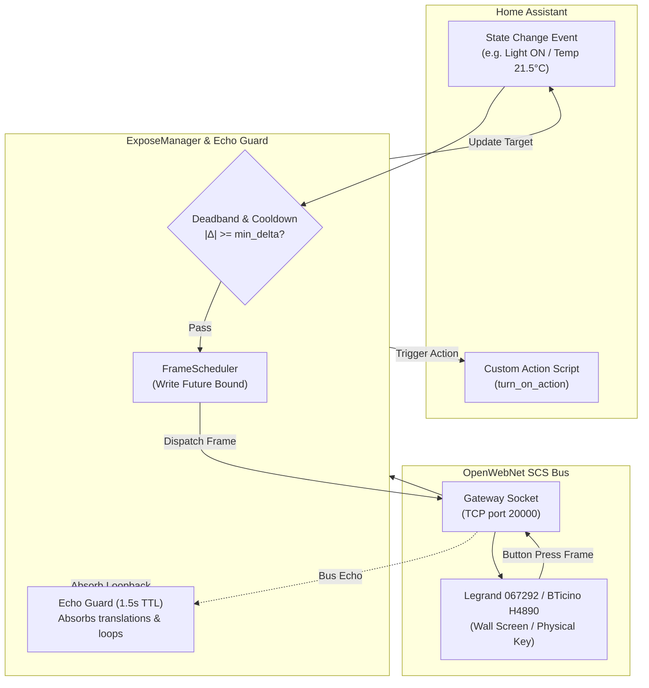

# Exposing Home Assistant Entities & Clock to SCS Bus

The **Expose to Bus** engine allows Home Assistant to project external smart home devices, sensors, energy meters, and the system clock directly onto the Legrand / BTicino OpenWebNet SCS bus on unused addresses.

By emulating virtual OpenWebNet devices, physical wall controls, touchscreens (such as the Legrand `067292`, BTicino `H4890`, `LN4890`, `AM4890`, or `10"` touchscreens), and bus supervisors can interact with non-MyHOME devices (e.g. Philips Hue, Zigbee/Matter lamps, Sonos players, Somfy blinds, Shelly relays, and ESPHome sensors) as if they were native SCS hardware.

---

## 🌟 Common Use Cases

1. **Touchscreen Control of Non-SCS Devices (`WHO = 1` & `WHO = 2`)**:
   Tap an icon or slider on a Legrand `067292` or BTicino `H4890` wall screen to control a Zigbee, Matter, or Wi-Fi device in Home Assistant. Changes made in Home Assistant or voice assistants instantly update the status icon and LED on the wall screen.
2. **Unpopulated Physical Wall Switches (`WHO = 1`)**:
   Use an unused rocker on an `H4652/2` or `K4652M2` physical wall control configured as a point-to-point light (`WHO = 1`) to toggle a TV, media player, or smart bulb with full LED status feedback.
3. **Virtual Temperature Probes (`WHO = 4`, gateway-dependent)**:
   On gateways whose `bt_termo` daemon translates `#0` temperature writes onto the SCS bus (verified on `F461`), publish an outdoor weather service temperature, Zigbee room sensor, or ESPHome probe onto an unused zone master address (`1..99`, `DIMENSION 0`). *(Rejected by `F454`, `MH200N`, `MH202`, and wall touchscreens such as `067292` / `H4890` — see [Gateway Compatibility](#gateway-compatibility-firmware-verification) below.)*
4. **Virtual Energy & Power Meters (`WHO = 18`, gateway-dependent)**:
   On gateways verified for `WHO = 18` dimension reports (`F461`), publish active power (`DIMENSION 113`, Watts) or energy totalizers (`DIMENSION 51..54`, Wh) onto OpenWebNet monitor sessions. *(Cannot inject synthetic power/energy onto a physical 2-wire SCS bus for `067292` / `H4890` wall touchscreens — see [Gateway Compatibility](#gateway-compatibility-firmware-verification) below.)*
5. **Bus Clock & Calendar Synchronization (`WHO = 13`)**:
   Keep all wall screens (`067292`, `H4890`, `10"` touchscreens), thermostats, and chronothermostats on the SCS bus synchronized to Home Assistant's local time, date, and daylight saving time (DST) across all gateway models.

---

## 🛠️ How to Configure

The integration supports two methods for configuring exposed bindings: **UI Config Subentries** (recommended) and **Declarative YAML** (`myhome.yaml`).

### Method 1: Home Assistant UI (Config Subentries)

In Home Assistant, exposed bindings are configured as **Config Subentries** on your gateway entry:

1. In Home Assistant, navigate to **Settings → Devices & Services → Integrations → MyHOME**.
2. Click on your gateway card (e.g. `F454`, `067292`, or `MyHomeServer1`).
3. Scroll down to the **Subentries** section (or click the three dots `⋮` menu in the upper corner).
4. Click **+ Add exposed entity** (or **Expose entity to SCS bus**).
5. Complete the setup form:

| Field | Description | Example |
| :--- | :--- | :--- |
| **WHO Subsystem** | The OpenWebNet domain to emulate (`1`, `2`, `4`, `13`, or `18`). | `WHO 1 — Lighting / Switch / Virtual Actuator` |
| **WHERE Address** | Unused SCS address assigned to the button/tile in **MyHOME_Suite**. *(Omit for WHO 13)* | `25` or `83` |
| **Source Entity** *(Optional on WHO 1/2 if custom actions are set)* | The Home Assistant entity providing state and commands. | `light.hue_living_room` |
| **State Attribute** *(Optional)* | Entity attribute providing the value (`brightness` for `WHO = 1` dimmers; `current_position` for `WHO = 2` covers). | `brightness` |
| **OpenWebNet Dimension** *(Optional)* | Dimension selector (`0` for temperature; `51..54` / `113` for energy/power; `0`, `1`, `22` for clock). *(Not used for WHO 1 or WHO 2)* | `0` |
| **Cooldown** *(Optional)* | Rate-limiting debounce window in seconds (default: `1.0` s). | `1.0` |
| **Minimum Delta** *(Optional)* | Deadband threshold; changes smaller than this value are not sent. | `0.5` |
| **Periodic Broadcast Interval** *(Optional)* | Interval in seconds for recurring heartbeat broadcasts. | `60` |
| **Respond to Bus Queries** | Reply to incoming `*#WHO*WHERE...##` status and dimension read requests (default: `true`). | `true` |
| **Bidirectional** | Act on incoming `WHO = 1` / `WHO = 2` bus commands and wall-switch presses (default: `true`). | `true` |
| **Brightness Step (%)** | Relative step size (`1..100%`) applied per `WHO = 1` dimmer step-up / step-down command (default: `10%`). | `25` |
| **Custom 'On' States** *(Optional)* | Comma-separated list of states considered ON (e.g. `on, playing, open`). | `on, playing` |
| **Value Template** *(Optional)* | Jinja2 template to extract or transform values before publishing. | `{{ value \| round(1) }}` |
| **Turn-on / Turn-off / Step-up / Step-down Actions** *(Optional)* | Visual Home Assistant action sequences overriding default entity service calls (`turn_on` / `turn_off` for `WHO = 1` & `WHO = 2`; `step_up` / `step_down` for `WHO = 1`; hidden for `WHO = 4`, `13`, and `18`). | `media_player.volume_up` |

Click **Submit**. The binding activates immediately without requiring a Home Assistant restart.

---

### Method 2: Declarative YAML (`myhome.yaml`)

You can also define exposed bindings in your `myhome.yaml` file under the gateway's MAC address:

```yaml
myhome:
  00:03:50:XX:XX:XX:   # Your Gateway MAC address
    expose:
      # -----------------------------------------------------------------
      # 1. Virtual Light / Dimmer (WHO = 1)
      # Short press on WHERE "83" turns the smart bulb ON/OFF; holding up/down
      # steps brightness by 25%. Setting 'attribute: brightness' also mirrors
      # brightness level changes back onto the bus.
      # -----------------------------------------------------------------
      - who: 1
        where: "83"
        entity_id: light.smart_bedroom
        attribute: brightness
        bidirectional: true
        brightness_step_pct: 25
        cooldown: 0.5

      # -----------------------------------------------------------------
      # 2. Virtual Cover / Shutter (WHO = 2)
      # Tapping up/down/stop on wall screen at WHERE "31" controls pergola curtain.
      # -----------------------------------------------------------------
      - who: 2
        where: "31"
        entity_id: cover.pergola_curtain
        bidirectional: true

      # -----------------------------------------------------------------
      # 3. Virtual Temperature Probe (WHO = 4, Dimension 0)
      # Publishes outdoor temperature onto unused zone master address 50
      # (1..99 required on F461 / bt_termo; 100..900 only on reply-injection gateways).
      # -----------------------------------------------------------------
      - who: 4
        where: "50"
        dimension: 0
        entity_id: sensor.outdoor_temperature
        cooldown: 5.0
        min_delta: 0.2
        periodic_send: 60

      # -----------------------------------------------------------------
      # 4. Virtual Active Power Meter (WHO = 18, Dimension 113)
      # Publishes grid active power (W) onto meter address 51.
      # Auto-converts kW -> W if the sensor unit of measurement is kW.
      # -----------------------------------------------------------------
      - who: 18
        where: "51"
        dimension: 113
        entity_id: sensor.grid_active_power
        cooldown: 2.0
        min_delta: 10.0

      # -----------------------------------------------------------------
      # 5. Virtual Energy Counter / Totalizer (WHO = 18, Dimension 51)
      # Publishes cumulative grid energy totalizer (Wh) onto meter address 51.
      # Auto-converts kWh -> Wh if the sensor unit of measurement is kWh.
      # -----------------------------------------------------------------
      - who: 18
        where: "51"
        dimension: 51
        entity_id: sensor.grid_energy_consumed
        cooldown: 5.0
        min_delta: 100.0   # Broadcast on 100 Wh increments

      # -----------------------------------------------------------------
      # 6. Bus Clock & DST Sync (WHO = 13, Dimension 22)
      # Broadcasts atomic time, date, and calendar once every hour.
      # Note: Set 'periodic_send: 0' for query-only mode (answers *#13** reads
      # without proactive pushes, ideal for NTP-synchronized gateways).
      # -----------------------------------------------------------------
      - who: 13
        dimension: 22
        periodic_send: 3600
        respond_to_read: true
```

---

## 💡 Virtual Dimmers & `MyHOME_Suite` Wall Control Modes (`WHO = 1` vs `CEN+`)

When using a physical 2-wire SCS wall control (such as BTicino `H4652/2`, `L4652/2`, `AM5832/2`, `K4652M2`, or Legrand `067552`) to dim a Home Assistant light on an **unpopulated** SCS address (an address with no physical BTicino actuator wired on the 2-wire bus):

### 1. Recommended `MyHOME_Suite` Modes for `WHO = 1` Expose
In **MyHOME_Suite**, configure the wall control channel as **Light control** (`Object 400`, *Beleuchtung/schalten*) with **Point-to-point** addressing (`A` / `PL`, e.g. `A = 8, PL = 3` → `WHERE = 83`) and either of the two standard two-button (`O/I`) dimmer modalities:

- **`ON/OFF and point to point dimming`** (`M = 9` — German: *"ON/OFF und Regelung nur Punkt-Punkt"*; identical to physical configurator `M = O/I`)
- **`ON/OFF and dimming`** (`M = 3` — German: *"EIN/AUS und Dimmerregelung"*)

Both modalities work identically for a point-to-point virtual dimmer:

- **Short press UP / DOWN**: Sends `*1*1000#1*WHERE##` / `*1*1000#0*WHERE##` to turn the Home Assistant entity ON or OFF and updates the wall control's status LED.
- **Hold DOWN**: Sends `*1*1000#31*WHERE##` and steps brightness down by `brightness_step_pct` (or runs `step_down_action`).
- **Hold UP**: Because no physical SCS dimmer hardware-ACKs the unpopulated address on the 2-wire bus, `H4652/2` repeats `*1*1000#1*WHERE##` every **~2 seconds** (with a ~200 ms SCS link-layer retry per step) instead of switching to `*1*1000#30*WHERE##`. `ExposeManager` automatically deduplicates the ~200 ms SCS retries and treats consecutive held `*1*1000#1*WHERE##` frames (`1.6–3.0 s` apart while the bound entity is already on) as `step_up` (`+brightness_step_pct` or `step_up_action`), while keeping single taps, quick double-presses, and turn-on from off idempotent.

> [!TIP]
> **Want faster (~0.5 s) smooth dimming without the ~2 s unacknowledged SCS timeout?**
> On `H4652/2` / `L4652/2` / `067552` / `K4652M2`, you can alternatively configure the module in **MyHOME_Suite** as **Scheduled scenario PLUS (`CEN+`, `WHO = 25`, `Object 406`)** instead of `WHO = 1` Expose. `CEN+` frames are broadcast events (`*25*21#<btn>*2<addr>##` short press, `22` hold start, `23` ~0.5 s hold repeat, `24` hold release) that require no physical actuator ACK on the 2-wire bus and appear directly as Home Assistant device triggers — at the trade-off that `CEN+` buttons do not track `WHO = 1` load-state LEDs or Area/General light commands.

---

## 🎛️ Advanced: Custom Script Actions

For complex integrations (such as cycling media playlists, executing sequences, or calling third-party services with conditions), you can configure `turn_on_action`, `turn_off_action`, `step_up_action`, and `step_down_action` either directly in the **UI Config Subentry** action pickers or in `myhome.yaml` using Home Assistant's native `Script` syntax:

```yaml
myhome:
  00:03:50:XX:XX:XX:
    expose:
      - who: 1
        where: "95"
        entity_id: media_player.kitchen_sonos
        on_states:
          - playing
        turn_on_action:
          - action: media_player.play_media
            target:
              entity_id: media_player.kitchen_sonos
            data:
              media_content_id: "http://icecast.radiofrance.fr/fip-midfi.mp3"
              media_content_type: "audio/mp3"
        turn_off_action:
          - action: media_player.media_pause
            target:
              entity_id: media_player.kitchen_sonos
        step_up_action:
          - action: media_player.volume_up
            target:
              entity_id: media_player.kitchen_sonos
        step_down_action:
          - action: media_player.volume_down
            target:
              entity_id: media_player.kitchen_sonos
```

### Action Script Variables & Templates

During script execution, the following template variables are available:

- `{{ this.state }}`: The current state of the source entity.
- `{{ entity_id }}`: The entity ID of the bound entity.
- `{{ who }}`: The OpenWebNet WHO subsystem integer (`1` or `2`).
- `{{ where }}`: The bound SCS WHERE address string.

> [!TIP]
> `{{ who }}` and `{{ where }}` are especially useful when sharing a single reusable Home Assistant script or automation action across multiple exposed wall keys or virtual actuators.

---

## 🔬 How the Expose Engine Works



### Key Architectural Invariants

1. **Write-Future-Bound Echo Guarding**:
   When Home Assistant sends a state mirror frame to the bus (e.g. `*1*1*25##` or `*#2*25*#11#001*50##`), gateways broadcast multi-frame translation echoes back onto the monitor session (`*1*1000#1*25##`, `*2*1000#0*25##`, `*#2*25*#11#001#1*50##`). The Expose engine tracks pending write futures and arms an echo-guard with a `1.5` s TTL to absorb these loops, preventing self-oscillations.
2. **Trailing-Edge Debouncing**:
   Rapid state changes (such as slider dragging in Home Assistant) are debounced within the `cooldown` window. Once the cooldown timer expires, the latest state is sent (eventual consistency).
3. **Queue Superseding**:
   A high-priority user command or wall-button press immediately supersedes any pending mirror frame for the same target, ensuring that an outdated state change never arrives after a button press.

---

## 🏛️ Gateway Compatibility & Firmware Verification

Different gateway models handle bus frame injection differently:

| OpenWebNet Domain | Gateway Compatibility | Required Frame Form | Notes |
| :--- | :---: | :--- | :--- |
| **`WHO = 1` (Lights / Switches)** | **All Gateways** | `*#1*WHERE*#1*LEVEL*0##` (or `*1*1*WHERE##` / `*1*0*WHERE##`) | Universal support across F454, F455, F459, MH200N, MH201, MH202, MHS1, F461, 067292, and H4890. |
| **`WHO = 2` (Covers / Shutters)** | **All Gateways** | `*#2*WHERE*#11#001*POS##` (or `*2*1/2/0*WHERE##`) | Universal support; translation echoes are cleanly absorbed. |
| **`WHO = 13` (Clock & DST)** | **All Gateways** | `*#13**#22*H*M*S*T*W*D*M*Y##` | Synchronizes on-screen clocks across all models (`067292`, `H4890`, `F454`, etc.). Set `periodic_send: 0` for query-only mode. |
| **`WHO = 4` (Virtual Temperature)** | Verified on **`F461`** (`WHERE` `1..99`) | `*#4*WHERE*#0*TTTT##` | `bt_termo` (`F461`) translates unused zone master addresses `1..99` (e.g. `"50"`) onto the SCS bus (`D1 <ZZ> 03 02 F0 <TT> <TT> 00`), but rejects 3-digit probe addresses (`100..900`). Rejected (`NACK`) for all addresses on `F454`, `F459`, `MH200N`, `MH202`, `067292`, `H4890`, and `H4684`. |
| **`WHO = 18` (Virtual Energy Meter)** | Verified on **`F461`** (TCP session only) | `*#18*WHERE*113*WATT##` | Rejected (`NACK`) by wall touchscreens (`067292`, `H4890`, `H4684`). `bt_supervisione` / `bt_energy` gateways (`F454`, `F459`, `MH200N`, `MH202`, `MHS1`, `F461`) `ACK` on TCP but emit an SCS active-power **read** request (`D1 A1 02 33 00 1D 00 00`), discarding the value — so synthetic `WHO = 18` readings cannot reach physical 2-wire SCS wall screens. |

> [!NOTE]
> For physical wall touchscreens (Legrand `067292`, Arteor `573958`, BTicino `H4890`, `LN4890`), configure virtual light/switch (`WHO = 1`), shutter (`WHO = 2`), or scenario tiles with unused point-to-point addresses in **MyHOME_Suite**, and add clock sync (`WHO = 13`). On a shared SCS bus with a primary gateway (e.g. `F454` + `067292`), create the expose subentries on the **primary** gateway and keep `WHO = 4` / `WHO = 18` undelegated on the primary gateway.

---

## 🔍 Diagnostics & Troubleshooting

- **Check Active Bindings**: Open **Settings → Devices & Services → MyHOME → Download Diagnostics**. The JSON file contains an `"expose"` section detailing all active bindings, throttles, and last-sent timestamps.
- **Unsupported / Unverified Gateway Warning**: The UI Config Subentry flow hides `WHO = 4` and `WHO = 18` on gateways whose firmware cannot inject them onto the SCS bus, and rejects 3-digit `WHO = 4` probe addresses (`100..900`) on `#0`-only gateways (`F461`). If a legacy YAML or pre-existing binding targets an unsupported gateway or address, a single warning is logged at startup (*"Expose WHO=... is disabled: gateway ... Nothing is sent for this binding"*).
- **Duplicate Address Error (`invalid_expose`)**: Each `(who, where, dimension)` triplet must be unique per gateway.
