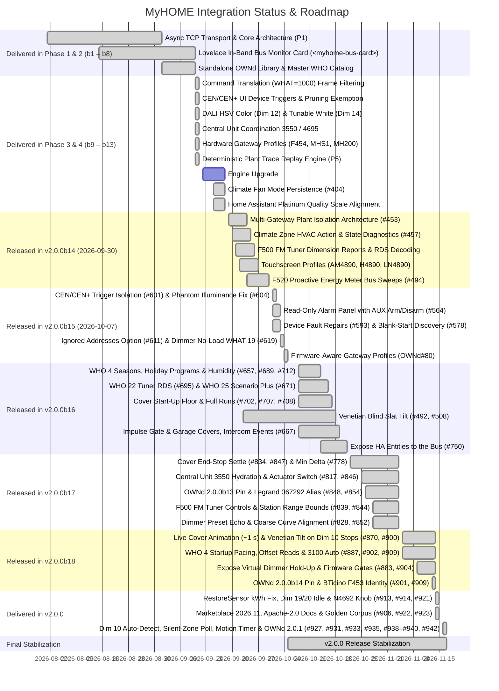

# MyHOME for Home Assistant — Project Roadmap & Architectural Status

Welcome to the development roadmap and architectural status overview for the **MyHOME for Home Assistant** integration.

Our overarching mission is to provide the most reliable, complete, and high-performance integration between Home Assistant and the BTicino / Legrand SCS OpenWebNet ecosystem. We adhere to strict standards: **zero-latency asynchronous architecture**, **hardware-level protocol fidelity**, **100% automated test coverage**, and **full Home Assistant Core 2025/2026 compatibility**.

> [!TIP]
> For release-by-release changelogs, download assets, and direct GitHub compare links across published versions, see [**GitHub Releases**](https://github.com/OpenWebNet-HA/MyHOME/releases).

---

## 🗺️ Current Delivery Status (v2.0.0 Stable Release Ready)

The major architectural milestones originally planned across Phases 1 through 4 have been **consolidated, fully implemented, and validated with 100% statement and branch test coverage** for **v2.0.0** on `OWNd==2.0.1`.



---

## 📦 What is Shipped & Operational in the v2.0.0 Series

The following table summarizes the completed architectural features and protocol subsystems verified for the v2.0.0 release:

| Priority / Feature | Subsystem | Implementation Status | Highlights |
|---|---|---|---|
| **Standalone Protocol Engine (P1)** | Core | ✅ **Shipped** (`OWNd==2.0.1`) | Fully decoupled, strongly typed async engine on PyPI; supports legacy clear-text, numeric, and modern HMAC-SHA1 / HMAC-SHA256 session handshakes plus firmware-aware gateway profiles. |
| **Expose HA Entities to the Bus** | Core / WHO=1, 2, 4, 13, 18 | ✅ **Shipped** (#750, #883, #904) | Declarative `expose` engine: virtual WHO 1 / WHO 2 actuators, firmware-gated WHO 4 / WHO 18 virtual probes, and the WHO 13 bus clock. |
| **Multi-Gateway Isolation Architecture** | Core / Routing | ✅ **Shipped** (#453) | Namespaced dispatchers, independent session queues, and cross-gateway bus protection eliminating cross-talk in multi-gateway installations. |
| **CEN / CEN+ UI Device Triggers (P2)** | WHO=15 / 25 | ✅ **Shipped** | Native Home Assistant UI device triggers with preserved 4-digit addressing (`"0001"`), parent gateway isolation, and all 8 press/held/release actions with repeat debouncing. |
| **In-Place Gateway Reconfiguration** | Config / Options | ✅ **Shipped** | Update IP address (`host`), `port`, or `password` via **Reconfigure**, and change hardware `model` or runtime options via **Configure** (Options Flow) without deleting devices or breaking entity IDs. |
| **Dynamic Command Worker Concurrency** | Transports | ✅ **Shipped** | User-configurable (1–4 workers) command concurrency automatically capped to hardware-safe limits per gateway model (e.g. 1 for MH200/MH201, 4 for F454/MHS1). |
| **Native Hardware Bus Timers** | WHO=1 | ✅ **Shipped** | Offloaded countdown timers on Legrand DIN actuators (F411) via the dedicated `myhome.turn_on_timed` service action (`0.5–918,000` seconds). |
| **Central Unit Coordination (P4)** | WHO=4 | ✅ **Shipped** (#817, #846, #909) | Dedicated master coordination for 99-zone Central Unit (`#0`, model 3550, including `*4*3100*#0##` auto restore) and 4-zone Central Unit (`#0#1`, model 4695). Master Seasonal switches propagate to subordinate zones. |
| **Climate Zone State Diagnostics** | WHO=4 | ✅ **Shipped** (#404, #457, #908, #914, #921, #933, #940) | Dynamic HVAC action deduction (`heating`, `cooling`, `idle` incl. Dimension 19/20 codes `14..16` & `100` and multi-actuator `F455` Dimension 19 status), `Dimension 11` / `20` fancoils, `Dimension 13` knob detents, fan mode persistence across restarts, and paced startup/silent-zone sweeps. |
| **Real-World CI Trace Replay Engine (P5)** | Testing / CI | ✅ **Shipped** | Automated pytest fixture engine (`tests/test_trace_replay.py`) replaying authentic on-wire captures across 12 physical gateway families directly against Home Assistant state machines. |
| **DALI Tunable White & Color** | WHO=1 | ✅ **Shipped** | DALI DT8 tunable white (Kelvin 2000K–6535K / mireds, Dimension 14), native HSV color promotion (Dimension 12), and smooth dimming speed curves. |
| **Declared Groups & Assumed State** | WHO=1 | ✅ **Shipped** (#368, #376, #377) | Lighting groups declared under `light:` (`where: '#G'`, optional `members:`) with aggregate/assumed-state inference and 500 ms debounced targeted status sweeps (`broadcast_resync`) upon intercepting group (`WHERE=#1`), area, or general (`WHERE=0`) frames. |
| **Cover Live Animation, Venetian Tilt & Travel Calibration** | WHO=2 | ✅ **Shipped** (#433, #870, #900) | ~1 s interpolated live travel-time positioning, `Dimension 10` / `11` position feedback, Venetian slat-tilt tracking across intermediate `Dimension 10` stops, dedicated cover run-stop locks, and on-bus stopwatch calibration (`myhome.calibrate_cover`, **Calibrate travel time**, and **Calibrate all covers**). |
| **Sound System 2.0, WHO 22 RDS Tuners & Streaming Proxy** | WHO=16 / 22 | ✅ **Shipped** (#695, #839, #844) | Multi-room matrix amplifier control (`F441`/`F441M` over `WHO = 16`), `F500`/`F500N` FM RDS tuner controls (`media_player`, `number`, `button`) on both `WHO = 22`-only (`MyHomeServer1`, `F461`) and dual-stack gateways, `4#<area>` active-source area tracking, and Dynamic Proxy Decoders for Music Assistant / Spotify. |
| **Door Entry Locks & Intercom Events** | WHO=6 / 8 | ✅ **Shipped** (#667) | Door lock release entities (`lock.py`, configurable hold pulse and optional PIN confirmation) and video intercom call event triggers. |
| **Energy Management & Metering** | WHO=18 | ✅ **Shipped** (#494, #907, #913) | Instantaneous active power (W), unit-safe `RestoreSensor` cumulative total/daily/monthly Wh/kWh counters, and proactive bus sweeps for `F520` / `F521` / `3522` DIN meters. |
| **Burglar Alarm** | WHO=5 | ✅ **Shipped** (#564) | Armed / disarmed / triggered state (read-only panel), zone 0 synchronization, `myhome_alarm_event` notifications, and optional AUX (`WHO = 9`) arming/disarming bridge for central units (`3485`/`3486`). |
| **Dry Contacts & Technical Alarms** | WHO=25 | ✅ **Shipped** | Dynamic discovery, device class suffix stripping (#247), inverted contact states, and event dispatching for Legrand 3477 binary sensors. |
| **Lovelace Bus Monitor Card** | Frontend | ✅ **Shipped** (`<myhome-openwebnet-bus-monitor>`) | Live scrolling stream, color-coded WHO badges, scoped custom element registry self-healing (#277), syntax injector, **`🔴 Start Trace` / `⏹ Stop Trace`** recording, and **`📋 Copy Trace`** / **`💾 Export Trace`** export. |

---

## 🏆 Integration Quality Scale (IQS) Alignment

MyHOME is engineered to achieve the **official Home Assistant 🥇 Platinum Quality Seal** ([Home Assistant Integration Quality Scale](https://developers.home-assistant.io/docs/core/integration-quality-scale/)) for potential Core inclusion, ensuring the highest architectural standards regardless of distribution model.

> [!NOTE]
> **Community Consultation on Upstream Core Inclusion vs. Independent Distribution**:  
> While the integration strictly adheres to 100% of Home Assistant Core Platinum standards, the maintainers and community have **not decided** on upstream Core inclusion. As discussed in community channels (see [RFC Discussion #248](https://github.com/orgs/OpenWebNet-HA/discussions/248)), there are important trade-offs:
>
> - **Benefits of Core inclusion**: Automatic out-of-the-box discovery for new Home Assistant users without requiring Marketplace / HACS installation; official documentation on `home-assistant.io`.
> - **Drawbacks & Advantages of remaining an independent custom component**:
>     - **Release Agility**: Rapid deployment of bugfixes, firmware quirk workarounds, and new WHO dimension features without waiting for monthly Home Assistant Core release windows.
>     - **Dedicated Diagnostic Frontend**: Continued bundling and rapid iteration of the in-band `<myhome-bus-card>` Lovelace tool and live bus monitors, which are constrained within Core repository guidelines.
>     - **Community Traces & Plant Fixtures**: Fast, unencumbered additions of real-world captures and experimental protocol options.
>
> Feedback from installers and users is actively welcomed in our Discussions.

All 54 quality scale rules are tracked in `custom_components/myhome/quality_scale.yaml` and continuously validated by `scripts/verify_ha_standards.py`:

```mermaid
graph LR
    subgraph Bronze["🥉 Bronze Tier (100% Satisfied)"]
        B1["has_entity_name = True"]
        B2["entry.runtime_data Mapping"]
        B3["async_setup Action Registration"]
        B4["Config Entry Unique IDs"]
    end

    subgraph Silver["🥈 Silver Tier (100% Satisfied)"]
        S1["100.0% Strict Test Coverage"]
        S2["ServiceValidationError Handlers"]
        S3["PARALLEL_UPDATES = 0 Declarations"]
        S4["No Blocking Event Loop Calls"]
    end

    subgraph Gold["🥇 Gold Tier (100% Satisfied)"]
        G1["async_step_reconfigure"]
        G2["strings.json & en.json Translations"]
        G3["icons.json Translatable Icons"]
        G4["Home Assistant Repairs Framework"]
        G5["diagnostics.py Platform"]
    end

    subgraph Platinum["💎 Platinum Tier (100% Satisfied)"]
        P1["Async Client Library (OWNd)"]
        P2["Zero HA Imports in Client Engine"]
        P3["Strict Anti-Drift Sentinels"]
    end

    Bronze --> Silver --> Gold --> Platinum
```



### 📋 Quality Scale Audit Highlights

1. **Bronze Tier**:
    - `has-entity-name`: All entity implementations inherit device names cleanly without manual `self.entity_id` overrides.
    - `runtime-data`: 100% single-source access via `entry.runtime_data` (`MyHOMERuntimeData`); zero legacy `hass.data[DOMAIN]` global lookups.
    - `action-setup`: Service actions registered once in `async_setup` and preserved across individual entry reloads.

2. **Silver Tier**:
    - `test-coverage`: Enforced strict 100.0% statement coverage across all integration modules (verified by `tests/test_coverage_enforcer.py` and `scripts/verify_ownd_coverage.py`).
    - `parallel-updates`: Explicit `PARALLEL_UPDATES = 0` declared across all 11 platform files to guarantee event-driven thread safety.

3. **Gold Tier**:
    - `reconfiguration-flow`: In-place gateway IP address (`host`), `port`, and `password` updates via **Reconfigure**, with hardware `model` and runtime options configurable via **Configure** (Options Flow).
    - `repair-issues`: Built-in repairs platform (`repairs.py`) raising user-actionable diagnostics (e.g. unconfigured gateway timezone sentinel `999`, unknown gateway model `999`, model conflicts, device faults).
    - `diagnostics`: Comprehensive diagnostics export with automatic redaction of passwords and tokens.

4. **Platinum Tier**:
    - `async-dependency`: Zero blocking network calls; standalone asynchronous client engine (`OWNd==2.0.1`) on PyPI.
    - `clean-separation`: OWNd engine imports zero Home Assistant symbols and runs independently on Linux/Windows/macOS.

---

## 📊 Real-World Trace Coverage Schematic (What We Have vs. What We Need)

To eliminate regression risks and verify complex timing constraints, our **Trace Replay Engine** (`tests/test_trace_replay.py`) replays authentic on-wire captures against the Home Assistant integration.

Below is the live, automatically synchronized status of real-world captures in CI, and remaining niche plant scenarios where community traces are welcomed:

### 🗺️ System Coverage Overview

```mermaid
graph TD
    subgraph Gateways["🏛️ Gateways & Transports"]
        GW_MHS1["🟢 MyHomeServer1<br/>(52 captures · 8,342 rx)"]
        GW_F454["🟢 F454<br/>(23 captures · 4,447 rx)"]
        GW_F455["🟢 F455<br/>(14 captures · 812 rx)"]
        GW_F459["🟢 F459<br/>(1 capture · 898 rx)"]
        GW_F461["🟢 F461<br/>(23 captures · 3,212 rx)"]
        GW_MH202["🟢 MH202<br/>(9 captures · 672 rx)"]
        GW_MH201["🟢 MH201<br/>(10 captures · 976 rx)"]
        GW_MH200N["🟢 MH200N<br/>(16 captures · 1,664 rx)"]
        GW_MH200["🟢 MH200<br/>(13 captures · 1,341 rx)"]
        GW_F453["🟢 F452 / F453 / F453AV<br/>(10 captures · 1,065 rx)"]
        GW_H4890["🟢 H4890 / AM4890 / 067292<br/>(5 captures · 983 rx)"]
        GW_H4684["🟢 H4684 / H/L4684<br/>(11 captures · 1,179 rx)"]
        GW_3578["🔴 Legrand 3578<br/>(Deferred to v2.1+ · #879)"]
    end

    subgraph Subsystems["⚙️ Protocol Subsystems & Edge Scenarios"]
        SUB_LIGHT["🟢 Lighting & Dimmers (WHO 1)<br/>(5,244 rx · 86 captures)"]
        SUB_DALI["🟢 DALI DT8 & HSV (WHO 1)<br/>(18 rx · 2 captures)"]
        SUB_TIMER["🟢 DIN Bus Timers (WHO 1)<br/>(8 rx · 5 captures)"]
        SUB_GRP["🟢 Lighting Groups (WHO 1)<br/>(27 rx · 10 captures)"]
        SUB_COV_V["🟢 Covers Timed & Calibrated (WHO 2)<br/>(1,419 rx · 57 captures)"]
        SUB_COV_H["🟢 Covers Dim 10 / 11 (WHO 2)<br/>(495 rx · 25 captures)"]
        SUB_COV_255["🟡 Uncalibrated Dim 10=255 (WHO 2)<br/>(Unit tests only)"]
        SUB_THERMO_ZONES["🟢 Zone Thermostats & Probes (WHO 4)<br/>(9,904 rx · 84 captures)"]
        SUB_CU3550["🟢 Central Unit 3550 (WHO 4)<br/>(286 rx · 22 captures)"]
        SUB_CU4695["🔴 Central Unit 4695 (WHO 4)<br/>(Physical capture needed)"]
        SUB_FANCOIL["🟢 Fancoils Dim 11/20 (WHO 4)<br/>(445 rx · 28 captures)"]
        SUB_ALARM["🟢 Burglar Alarm (WHO 5)<br/>(273 rx · 12 captures)"]
        SUB_DOOR["🟢 Door Entry (WHO 6/8)<br/>(42 rx · 5 captures)"]
        SUB_DRY["🟢 AUX & Dry Contacts (WHO 9/25)<br/>(210 rx · 15 captures)"]
        SUB_CEN["🟢 CEN / CEN+ Triggers (WHO 15/25)<br/>(95 rx · 20 captures)"]
        SUB_SCENARIOS["🟢 Scenarios (WHO 0/17)<br/>(33 rx · 7 captures)"]
        SUB_LOCK14["🟢 Actuator Locks (WHO 14)<br/>(24 rx · 6 captures)"]
        SUB_WHO16["🟢 Audio Matrix (WHO 16)<br/>(431 rx · 22 captures)"]
        SUB_WHO22["🟢 Sound Diffusion & RDS (WHO 22)<br/>(404 rx · 18 captures)"]
        SUB_ENERGY["🟢 Energy Metering (WHO 18)<br/>(1,425 rx · 27 captures)"]
        SUB_DIAG["🟢 Gateway Identity (WHO 13/1013)<br/>(1,204 rx · 80 captures)"]
        SUB_ROUTER["🟢 F422 Cross-Bus (#4#bus)<br/>(420 rx · 15 captures)"]
    end

    subgraph Engine["🧪 CI Replay & Regression Suite"]
        HARNESS["tests/test_trace_replay.py & fixture tests<br/>(Deterministic On-Wire Replay)"]
    end

    GW_MHS1 --> HARNESS
    GW_F454 --> HARNESS
    GW_F455 --> HARNESS
    GW_F459 --> HARNESS
    GW_F461 --> HARNESS
    GW_MH202 --> HARNESS
    GW_MH201 --> HARNESS
    GW_MH200N --> HARNESS
    GW_MH200 --> HARNESS
    GW_F453 --> HARNESS
    GW_H4890 --> HARNESS
    GW_H4684 --> HARNESS
    SUB_LIGHT --> HARNESS
    SUB_DALI --> HARNESS
    SUB_TIMER --> HARNESS
    SUB_GRP --> HARNESS
    SUB_COV_V --> HARNESS
    SUB_COV_H --> HARNESS
    SUB_THERMO_ZONES --> HARNESS
    SUB_CU3550 --> HARNESS
    SUB_FANCOIL --> HARNESS
    SUB_ALARM --> HARNESS
    SUB_DOOR --> HARNESS
    SUB_DRY --> HARNESS
    SUB_CEN --> HARNESS
    SUB_SCENARIOS --> HARNESS
    SUB_LOCK14 --> HARNESS
    SUB_WHO16 --> HARNESS
    SUB_WHO22 --> HARNESS
    SUB_ENERGY --> HARNESS
    SUB_DIAG --> HARNESS
    SUB_ROUTER --> HARNESS

    classDef covered fill:#2e7d32,stroke:#1b5e20,color:#ffffff;
    classDef partial fill:#f57f17,stroke:#e65100,color:#ffffff;
    classDef needed fill:#c62828,stroke:#b71c1c,color:#ffffff;
    class GW_MHS1,GW_F454,GW_F455,GW_F459,GW_F461,GW_MH202,GW_MH201,GW_MH200N,GW_MH200,GW_F453,GW_H4890,GW_H4684,SUB_LIGHT,SUB_DALI,SUB_TIMER,SUB_GRP,SUB_COV_V,SUB_COV_H,SUB_THERMO_ZONES,SUB_CU3550,SUB_FANCOIL,SUB_ALARM,SUB_DOOR,SUB_DRY,SUB_CEN,SUB_SCENARIOS,SUB_LOCK14,SUB_WHO16,SUB_WHO22,SUB_ENERGY,SUB_DIAG,SUB_ROUTER covered;
    class SUB_COV_255 partial;
    class GW_3578,SUB_CU4695 needed;
```

<!-- ROADMAP_COVERAGE_MERMAID_START -->

<!-- ROADMAP_COVERAGE_MERMAID_END -->

---

### 🏛️ Table 1: Gateway Models & Hardware Transports

<!-- ROADMAP_GATEWAY_TABLE_START -->
| Gateway Model | Status | Current Evidence / Fixture | Community Trace Needed / Target Scenario |
| :--- | :--- | :--- | :--- |
| **MyHomeServer1 (MHS1)** | 🟢 **Covered** | 52 physical captures (8,342 `rx` frames; `WHO = 1, 2, 4, 7, 8, 9, 13, 14, 15, 18, 22, 25, 1000, 1001, 1013`) — e.g. `tests/fixtures/traces/issue_466/`, `tests/fixtures/traces/who4_four_gateways_2026_11_18/` | *None needed — cloud/local hybrid gateway plant active in CI.* |
| **F454** | 🟢 **Covered** | 23 physical captures (4,447 `rx` frames; `WHO = 0, 1, 2, 4, 5, 9, 13, 14, 18, 25, 1013`) — e.g. `tests/fixtures/traces/issue_429/`, `tests/fixtures/traces/issue_466/` | *None needed — high-speed multi-session IP webserver active in CI.* |
| **F455** | 🟢 **Covered** | 14 physical captures (812 `rx` frames; `WHO = 1, 2, 4, 13, 25, 1001, 1013`) — e.g. `tests/fixtures/traces/issue_466/`, `tests/fixtures/traces/central_restore_3100_live_2026-11-12/` | *None needed — single-bus DIN IP gateway active in CI.* |
| **F459** | 🟢 **Covered** | 1 physical capture (898 `rx` frames; `WHO = 1, 2, 4, 13, 1013`) — e.g. `tests/fixtures/traces/issue_466/` | *None needed — WHO 1013 code 65 & WHO 4 capture active in CI.* |
| **F461 Web Server** | 🟢 **Covered** | 23 physical captures (3,212 `rx` frames; `WHO = 1, 2, 4, 13, 14, 1001, 1013`) — e.g. `tests/fixtures/traces/f461_live_2026-10-24/`, `tests/fixtures/traces/f461_live_2026-10-15/` | *None needed — DIN Ethernet Web Server (DALI DT8 & fancoils) active in CI.* |
| **MH202** | 🟢 **Covered** | 9 physical captures (672 `rx` frames; `WHO = 1, 2, 4, 5, 6, 8, 9, 13, 14, 16, 18, 22, 25, 1013`) — e.g. `tests/fixtures/traces/issue_466/`, `tests/fixtures/traces/mh202_sound_intercom_ducking/` | *None needed — modern scenario programmer plant active in CI.* |
| **MH201** | 🟢 **Covered** | 10 physical captures (976 `rx` frames; `WHO = 0, 1, 2, 4, 13, 15, 18, 25`) — e.g. `tests/fixtures/traces/issue_466/`, `tests/fixtures/traces/mh201-fresh-discovery-20260930.log` | *None needed — single-worker scenario programmer plant active in CI.* |
| **MH200N** | 🟢 **Covered** | 16 physical captures (1,664 `rx` frames; `WHO = 0, 1, 2, 4, 5, 9, 13, 15, 16, 17, 18, 22, 25, 1001, 1013, 1022`) — e.g. `tests/fixtures/traces/issue_466/`, `tests/fixtures/traces/f500_tuner/` | *None needed — second-generation scenario programmer active in CI.* |
| **MH200** *(Legacy)* | 🟢 **Covered** | 13 physical captures (1,341 `rx` frames; `WHO = 1, 2, 5, 6, 8, 9, 13, 16, 17, 1001, 1013`) — e.g. `tests/fixtures/traces/issue_466/`, `tests/fixtures/traces/mh200_sound_f441m/` | *None needed — legacy single-session plant & F441M audio active in CI.* |
| **F452 / F453 / F453AV** | 🟢 **Covered** | Traced `F453AV, F453`: 10 physical captures (1,065 `rx` frames; `WHO = 1, 2, 4, 5, 13, 25, 1001, 1013`) — e.g. `tests/fixtures/traces/issue_619/`, `tests/fixtures/traces/discussion_770_f453_n4692/` | *Family covered by physical `F453AV` & `F453` captures; optional legacy `F452 / F452V` captures welcomed.* |
| **H4890 / AM4890 / 067292** | 🟢 **Covered** | Traced `H4890, 067292`: 5 physical captures (983 `rx` frames; `WHO = 1, 2, 4, 5, 9, 13, 16, 18, 22, 25`) — e.g. `tests/fixtures/traces/issue_832/`, `tests/fixtures/traces/issue_466/` | *None needed — 3.5" touchscreen IP gateways (BTicino & Legrand) active in CI.* |
| **H4684 / H/L4684** | 🟢 **Covered** | Traced `H/L4684`: 11 physical captures (1,179 `rx` frames; `WHO = 1, 2, 3, 4, 5, 6, 9, 13, 16, 22, 1001, 1004`) — e.g. `tests/fixtures/traces/issue_466/` | *None needed — colour touchscreen IP gateway (FW 2.x & 6.x) active in CI.* |
| **Legrand 3578 USB/Serial** | 🔴 **Deferred (v2.1+)** | Deferred out of `v2.0.0` ([Discussion #879](https://github.com/orgs/OpenWebNet-HA/discussions/879)) | **Hardware tester & raw serial stream**: Active tester + raw byte capture ([Issue #466](https://github.com/OpenWebNet-HA/MyHOME/issues/466)) from a physical OpenZigBee installation (`WHERE=<id>#9`). |

*Table 1 is automatically generated and verified from physical bus captures in `tests/fixtures/` and supported models in `custom_components/myhome/const.py` by `scripts/sync_documentation.py`.*
<!-- ROADMAP_GATEWAY_TABLE_END -->

---

### ⚙️ Table 2: Subsystems, Dimensions & Edge Scenarios

<!-- ROADMAP_SUBSYSTEM_TABLE_START -->
| Subsystem & Domain | Status | Current Evidence / Fixture | Community Trace Needed / Target Scenario |
| :--- | :--- | :--- | :--- |
| **Lighting (WHO = 1) — Relays & Dimmers** | 🟢 **Covered** | 5,244 physical `rx` frames across 86 captures on 13 gateway models — e.g. `tests/fixtures/traces/issue_466/`, `tests/fixtures/traces/issue_629/` | *Baseline covered across standard, 4-digit, and F418/F418U2 dimmers.* |
| **Lighting (WHO = 1) — DALI Tunable White & HSV Color** | 🟢 **Covered** | 18 physical `rx` frames across 2 captures on 1 gateway model — e.g. `tests/fixtures/plants/issue_288_f461_dali_dt8/`, `tests/fixtures/traces/issue_466/` | *Baseline covered (`Dimension 12` HSV & `Dimension 14` Kelvin/mireds).* |
| **Lighting (WHO = 1) — Native DIN Timers** | 🟢 **Covered** | 8 physical `rx` frames across 5 captures on 3 gateway models — e.g. `tests/fixtures/plants/issue_311_f454/`, `tests/fixtures/traces/f461_live_2026-10-15/` | *Preset temporization & `Dimension 2` replies covered; optional mid-countdown `*#1*WHERE*2*H*M*S##` (`H/M/S > 0`) trace welcomed.* |
| **Lighting (WHO = 1) — Groups & General Broadcasts (P7)** | 🟢 **Covered** | 27 physical `rx` frames across 10 captures on 6 gateway models — e.g. `tests/fixtures/traces/issue_466/`, `tests/fixtures/traces/f461_live_2026-10-15/` | *None needed — group (`#G`) and general (`WHERE=0`) resync engine active in CI.* |
| **Covers (WHO = 2) — Travel-Time Positioning & On-Bus Calibration** | 🟢 **Covered** | 1,419 physical `rx` frames across 57 captures on 13 gateway models — e.g. `tests/fixtures/traces/issue_466/`, `tests/fixtures/traces/discussion_856/`; plus 23 calibrated `cover_travel_times` profiles in `tests/fixtures/traces/discussion_856/`, `tests/fixtures/traces/mh200_sound_f441m/` | *Baseline covered (stopwatch `myhome.calibrate_cover` runs, `cover_travel_times` profiles, and timed slat pulses active in CI).* |
| **Covers (WHO = 2) — Advanced Position (`Dim 10 / 11`)** | 🟢 **Covered** | 495 physical `rx` frames across 25 captures on 6 gateway models — e.g. `tests/fixtures/traces/issue_466/`, `tests/fixtures/traces/discussion_770_f454_f401/` | *Baseline covered (`F401` / `LN4661M2` percentage position; the slat angle is not on the bus).* |
| **Covers (WHO = 2) — Uncalibrated Hardware Sentinel (`Dim 10` `LEVEL=255`)** | 🟡 **Synthetic** | Unit tests for `*#2*WHERE*10*BS*255*...##` in `tests/test_cover.py` (0 physical `LEVEL=255` `rx` frames in `tests/fixtures/`) | **Uncalibrated actuator trace**: Bus capture of an uncalibrated `F401`, `LN4672M2`, or `067557` reporting `*#2*WHERE*10*BS*255*...##` prior to *Push&Learn* end-stop learning. |
| **Thermoregulation (WHO = 4) — Zone Thermostats, Probes & Humidity** | 🟢 **Covered** | 9,904 physical `rx` frames across 84 captures on 13 gateway models — e.g. `tests/fixtures/traces/issue_466/`, `tests/fixtures/traces/issue_429/` | *Baseline covered (zone temperature `Dim 0`, setpoints `Dim 12/14`, knob offsets `Dim 13` & `Dim 60` humidity).* |
| **Thermoregulation (WHO = 4) — 99-Zone Central Unit 3550 (`#0`)** | 🟢 **Covered** | 286 physical `rx` frames across 22 captures on 8 gateway models — e.g. `tests/fixtures/traces/central_restore_3100_live_2026-11-12/`, `tests/fixtures/traces/issue_466/` | *Baseline covered (`#0` master modes, `*4*3100*#0##` auto restore, & zone sync).* |
| **Thermoregulation (WHO = 4) — 4-Zone Central Unit 4695 (`#0#1`)** | 🔴 **Needed** | Synthetic unit tests in `tests/test_climate.py` only (0 inbound `#0#1` `rx` frames in `tests/fixtures/`) | **4-zone central unit trace**: Physical capture from a plant running a 4-zone `4695` / `HD4695` (`#0#1`) central unit. |
| **Thermoregulation (WHO = 4) — Fancoils (`Dim 11 / 20`)** | 🟢 **Covered** | 445 physical `rx` frames across 28 captures on 4 gateway models — e.g. `tests/fixtures/traces/issue_466/`, `tests/fixtures/traces/f461_live_2026-10-15/` | *Baseline covered (`Dimension 11` fan speeds & `Dimension 20` fan-coil states `5`–`8`).* |
| **Burglar Alarm (WHO = 5)** | 🟢 **Covered** | 273 physical `rx` frames across 12 captures on 7 gateway models — e.g. `tests/fixtures/traces/issue_466/`, `tests/fixtures/plants/issue_311_f454/` | *Baseline covered (physical `3486` / `MH202` partition & zone captures active in CI).* |
| **Door Entry & Intercom Locks (WHO = 6 / 8)** | 🟢 **Covered** | 42 physical `rx` frames across 5 captures on 4 gateway models — e.g. `tests/fixtures/traces/issue_466/`, `tests/fixtures/traces/mh202_sound_intercom_ducking/` | *Baseline covered (door lock release & video intercom call events active in CI).* |
| **AUX & Dry Contacts (WHO = 9 / 25)** | 🟢 **Covered** | 210 physical `rx` frames across 15 captures on 9 gateway models — e.g. `tests/fixtures/traces/issue_466/`, `tests/fixtures/traces/mh202_sound_intercom_ducking/` | *Baseline covered (`WHO = 9` auxiliary channels & `3477` / `F428` contact sensors).* |
| **CEN / CEN+ Pushbuttons & Rotary Triggers (WHO = 15 / 25)** | 🟢 **Covered** | 95 physical `rx` frames across 20 captures on 6 gateway models — e.g. `tests/fixtures/traces/issue_466/`, `tests/fixtures/traces/issue_434/` | *Baseline covered (short, long-press, repeat & release active in CI); a `WHO = 25` rotary capture (`WHAT = 25..28`) is welcome.* |
| **Scenarios & Schedulers (WHO = 0 / 17)** | 🟢 **Covered** | 33 physical `rx` frames across 7 captures on 3 gateway models — e.g. `tests/fixtures/traces/issue_466/`, `tests/fixtures/traces/f500_tuner/` | *Baseline covered (`WHO = 0` activation on an F454, `WHO = 17` frames on MH200 / MH200N).* |
| **Actuator Maintenance Locks (WHO = 14)** | 🟢 **Covered** | 24 physical `rx` frames across 6 captures on 4 gateway models — e.g. `tests/fixtures/plants/issue_247_myhomeserver1/`, `tests/fixtures/traces/f461_who14_live_2026-10-18/` | *Baseline covered (hardware pushbutton lock/unlock status frames active in CI).* |
| **Sound System (WHO = 16) — Matrix & Streaming Proxy** | 🟢 **Covered** | 431 physical `rx` frames across 22 captures on 5 gateway models — e.g. `tests/fixtures/traces/issue_466/`, `tests/fixtures/traces/mh200_sound_f441m/` | *Baseline covered (`F441` / `F441M` matrix routing, group takeover & ducking).* |
| **Sound Diffusion (WHO = 22) — FM RDS Tuners & Active-Source Sync** | 🟢 **Covered** | 404 physical `rx` frames across 18 captures on 5 gateway models — e.g. `tests/fixtures/traces/issue_466/`, `tests/fixtures/traces/f500_tuner/` | *Baseline covered (`F500` / `F500N` FM RDS tuners on `WHO = 22`-only & dual-stack gateways, `4#<area>` active-source tracking, and `H4562` `WHO = 22` zone captures).* |
| **Energy Management & Metering (WHO = 18)** | 🟢 **Covered** | 1,425 physical `rx` frames across 27 captures on 6 gateway models — e.g. `tests/fixtures/traces/issue_466/`, `tests/fixtures/traces/issue_907/` | *Baseline covered (`F520` / `F521` / `3522` active power `W` and total/daily/monthly `Wh` energy counters).* |
| **Gateway Clock, Identity & Diagnostics (WHO = 13 / 1001–1022)** | 🟢 **Covered** | 1,204 physical `rx` frames across 80 captures on 13 gateway models — e.g. `tests/fixtures/traces/issue_466/`, `tests/fixtures/traces/mh200_sound_f441m/` | *Baseline covered (`WHO = 13` device type/firmware/clock & `WHO = 1013` `OBJECT_MODEL`).* |
| **F422 Cross-Bus Router (`#4#<bus>`)** | 🟢 **Covered** | 420 physical `rx` frames across 15 captures on 4 gateway models — e.g. `tests/fixtures/traces/issue_466/`, `tests/fixtures/plants/issue_288_f461_dali_dt8/` | *None needed — physical F422 local-bus routing (`#4#01`, `#4#02`, ...) active in CI.* |

*Table 2 is automatically generated and verified from inbound (`rx`) OpenWebNet frames and calibration bundles in `tests/fixtures/` by `scripts/sync_documentation.py`.*
<!-- ROADMAP_SUBSYSTEM_TABLE_END -->

---

### 📋 Dual-Track Guide: How Community Testers Can Submit a Trace

We offer **two simple ways** to contribute real-world bus traces, tailored to your technical setup:

#### 🏷️ Track A: Zero-CLI via Home Assistant UI (Fastest & Easiest)
Ideal for standard users running Home Assistant with the MyHOME integration:

1. **Sweep the Bus**: In Home Assistant, go to **Developer Tools** > **Services** and call `myhome.sweep_bus` (or trigger it from the Lovelace Bus Monitor Card). This actively queries all lighting, cover, HVAC, and gateway diagnostic states in under 3 seconds.
2. **Download Diagnostics**: Navigate to **Settings** > **Devices & Services** > **MyHOME** > click the three dots (`⋮`) > **Download diagnostics** (or click **`💾 Export Trace`** / **`📋 Copy Trace`** on the Bus Monitor card).
3. **Submit**: Attach the downloaded `.json` file to [**RFC Discussion #248**](https://github.com/orgs/OpenWebNet-HA/discussions/248) or open a GitHub Issue.
4. *Privacy Guarantee*: Home Assistant and MyHOME automatically redact all passwords, authentication tokens, and private credentials before exporting.

#### 💻 Track B: Standalone Python Tool (Test Benches & Integrators)
Ideal for installers, bench testers, and developers testing isolated gateways without Home Assistant installed:

1. **Run the Trace Recorder**:
   ```bash
   python scripts/record_gateway_trace.py --host 192.0.2.35 --password 12345 --model MH202
   ```
2. **Active Sweep & Listen**: The script automatically executes the diagnostic status sweep, listens for ambient button presses or scenario bursts, and scrubs sensitive credentials.
3. **Drop & Commit**: The tool writes a complete ready-to-test fixture folder in `tests/fixtures/plants/<model>_plant/`.
4. **Instant CI Verification**: Run `pytest tests/test_trace_replay.py` — our parameterized test runner automatically discovers and tests your plant with zero additional test code required! Submit a Pull Request.

---

## 💬 Community Links & Resources

Please share your feedback, real-world bus captures, and questions in our community channels:

👉 **[GitHub Releases & Changelogs](https://github.com/OpenWebNet-HA/MyHOME/releases)** — Release notes and download archives  
👉 **[Join the Community Discussion on RFC #248](https://github.com/orgs/OpenWebNet-HA/discussions/248)**  
👉 **[Report Issues or Submit Bus Traces](https://github.com/OpenWebNet-HA/MyHOME/issues)**
